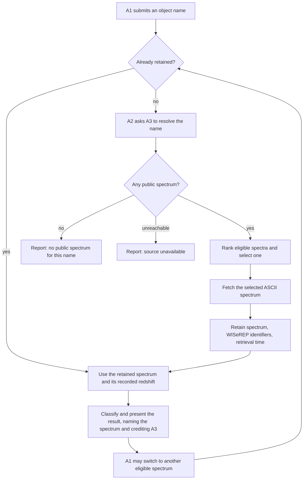
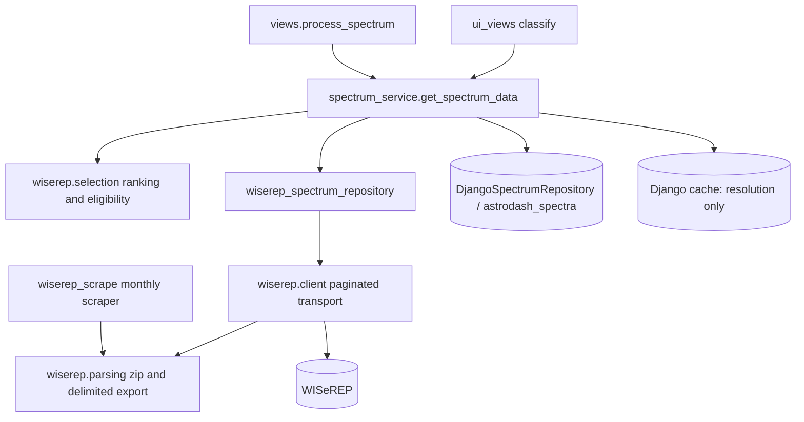
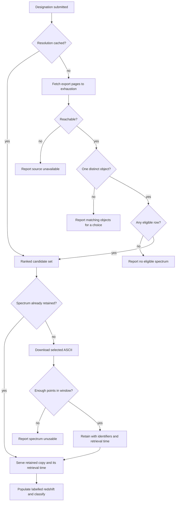

# Spectrum Lookup by Name from WISeREP - Plan

## Goal Capsule

- **Objective:** A researcher who already knows which transient they want obtains a classification by typing its name, without leaving AstroDash to locate, download, and upload a spectrum file.
- **Means:** Repoint the existing by-name lookup from the Open Supernova Catalog to WISeREP, and retain each fetched spectrum together with the identifiers that locate it upstream.
- **Product authority:** Requested by @gnarayan via Slack and recorded in scimma/astrodash#26, open since 2026-03-26. Product behaviour below was settled in dialogue with the maintainer on 2026-10-05 and 2026-10-07; the Product Contract wins on behaviour, Key Technical Decisions win on mechanism within it.
- **Execution profile:** One work unit, landed as a single branch, with everything running in the container rather than a host virtualenv. Code follows the project's Python conventions: `black` formatting, type hints on new signatures, Google-style docstrings, and `logging` in place of `print`.
- **Stop conditions:** Stop and ask if WISeREP's structured export stops carrying the columns KTD1 depends on, if removing the catalogue client turns out to break a surface outside the two call sites named in Sources, or if the retention schema change cannot be applied to the DEV database.
- **Who finishes it:** The maintainer reviews and merges; `ce-work` or a human may implement. Pushing goes to the `bot` remote only, and the pull request targets `scimma/astrodash`.
- **Open blockers:** None. Whether the Slack thread behind scimma/astrodash#26 adds requirements was converted to a stated assumption at the maintainer's direction rather than resolved; see Dependencies / Assumptions.
- **Product Contract preservation:** changed - added R19-R22 and restated R6, both confirmed by the maintainer on 2026-10-07. R6's ranking rule changed because WISeREP never populates the phase column it depended on; R19-R22 close four paths research found that would each return a confident classification of the wrong thing. AE10 was replaced for the same reason. Document review then corrected three Product Contract lines to match decisions already made rather than to make new ones: R9 now states the known-redshift flag is set, which the settled redshift decision chose but the requirement had omitted; R10 says what the provenance label does once the researcher edits the value; and R22 says that a resolution which cannot be completed is refused rather than ranked from a partial set. AE18, AE19 and AE20 were added for the behaviour those corrections commit. The walkthrough then settled both open items: the resolved candidate set is persisted durably so the no-outbound-request guarantee holds as written, which let AE5 drop its cache-lifetime qualifier; and the latency criterion gained explicit ceilings. No other requirement's meaning changed and no ID was renumbered.

---

## Product Contract

### Summary

The name field already present in the classify form resolves against WISeREP instead of the Open Supernova Catalog. It selects one public spectrum by a documented rule, populates the redshift with its source labelled, classifies, and retains the spectrum with its WISeREP identity so the result can be reproduced and a repeat lookup makes no outbound request.

### Problem Frame

A researcher who knows which transient they want still leaves AstroDash to get its spectrum: search WISeREP, download an ASCII file, return, upload it. On 2026-09-29 the maintainer ran exactly that round trip for 2026puh, and the file it produced is byte-identical (md5 `9a2cdbacdbc4405515ce8a3431b6537f`) to what one WISeREP name query returns. The request has been open since 2026-03-26.

A by-name path already exists, and its condition is part of the problem rather than a head start. `app/astrodash/forms.py:87` carries the name field, and resolution runs through `app/astrodash/domain/services/spectrum_service.py:83` to the Open Supernova Catalog at `api.astrocats.space`. That host's TLS certificate expired on 2026-09-22 and its chain does not verify; the path continues to work only because `app/astrodash/infrastructure/storage/file_spectrum_repository.py:483` and `:526` pass `verify=False`. Removing that flag, which is the correct fix, breaks by-name lookup outright.

The same code carries two further defects a replacement must not inherit. It reads `data[obj_name]["spectra"][0][1]` at `:508`, so of the 30 epochs the catalog returns for SN2002er the researcher classifies whichever happens to arrive first. And `:522` initialises `redshift = 0.0` while `:535` swallows a failed redshift fetch at debug level, so a classification can run at redshift zero without saying so.

### Key Decisions

- **WISeREP replaces the Open Supernova Catalog as the by-name source.** (session-settled: user-directed - chosen over keeping OSC alongside WISeREP: the catalog is decaying and its path depends on a disabled TLS check.) Governs R1, R2, R16.
- **WISeREP is the only external source; TNS is out of scope.** (session-settled: user-approved - chosen over TNS as a fallback name resolver: WISeREP resolves IAU, AT/SN-prefixed and survey internal designations and returns redshift and type, so a TNS bot id would introduce the application's first API-key secret for no demonstrated coverage gain.) Governs R3, R4.
- **One epoch is selected automatically rather than presented as a list, and the selection is named and changeable.** (session-settled: user-approved - chosen over always presenting the epoch list first: preserves the single-step flow while refusing the silent first-epoch pick the current path makes.) Governs R7, R8.
- **The automatically selected epoch is the earliest eligible observation.** (session-settled: user-approved - chosen over ranking by the quality flag first and over taking the most recent observation: WISeREP never populates its phase column, so a near-peak rule cannot run, and the earliest spectrum is normally the classification epoch.) Governs R6.
- **The lookup refuses rather than guesses whenever it cannot identify the right spectrum.** (session-settled: user-directed - chosen over shipping without these guards: each omission hands a researcher a confident classification of something other than what they asked for.) Governs R19, R20, R21, R22.
- **The redshift is populated from WISeREP and labelled as such.** (session-settled: user-approved - chosen over requiring the researcher to affirm it before use: a name becomes a complete classification in one step, and the value's origin is never implicit.) Governs R9, R10, R11.
- **A fetched spectrum is retained with its provenance and reused.** (session-settled: user-approved - chosen over a live passthrough that retains nothing: reproducibility bears on the citations metric in `STRATEGY.md`, and an uncached user-facing path would contradict the deliberate one-second request delay the offline scraper applies to the same service.) Governs R12, R13, R14.
- **This ships as one work unit rather than a feature plus a separate security fix.** (session-settled: user-directed - chosen over deferring the catalog removal to its own change: the requester asked for the whole thing.) Governs R15.
- **By-name entry gets its own completion-rate metric rather than being folded into the upload metric.** (session-settled: user-approved - chosen over widening the existing denominator to cover both paths: widening would break continuity with the figures already collected and would hide which entry path works.)
- **Only publicly released spectra are eligible.** WISeREP marks proprietary spectra and carries an end-of-proprietary-period field; serving an embargoed spectrum is not a tradeoff anyone chose. Governs R5.

### Actors

- A1. The researcher, who knows an object designation and wants a classification.
- A2. AstroDash, which resolves the designation, selects a spectrum, classifies it, and retains what it fetched.
- A3. WISeREP, an external archive operated by another group, which answers anonymous search and file requests.

### Key Flows

- F1. First lookup of a name
  - **Trigger:** A1 submits an object designation with no spectrum file.
  - **Actors:** A1, A2, A3
  - **Steps:**
    1. A2 resolves the designation against A3, reading every page of the export.
    2. A2 stops and reports the matches when more than one distinct object matched (R19).
    3. A2 narrows to eligible rows (R5, R20) and ranks them (R6).
    4. A2 downloads the selected spectrum and rejects it when too sparse to classify (R21).
    5. A2 retains it with its identifiers and retrieval time, populates the redshift, classifies, and presents the result naming the spectrum and crediting A3.
  - **Outcome:** A1 has a classification and can see which spectrum produced it.
  - **Covered by:** R1, R3, R4, R5, R6, R7, R9, R10, R12, R14, R19, R20, R21, R22
- F2. Switching epoch
  - **Trigger:** A1 chooses a different spectrum for a name already resolved.
  - **Actors:** A1, A2, A3
  - **Steps:** A2 re-derives the eligible set server-side rather than trusting the submitted choice, selects the newly chosen spectrum without A1 re-entering the name, retains it as in F1 if not already held, reclassifies, and updates the redshift and the named spectrum.
  - **Outcome:** A1 compares classifications across epochs of one object.
  - **Covered by:** R8, R12, R13
- F3. Repeat lookup
  - **Trigger:** A1 submits a designation whose selected spectrum A2 already holds.
  - **Actors:** A1, A2
  - **Steps:** A2 serves the retained spectrum and its recorded redshift; classifies; presents the result with the retrieval time of the held copy.
  - **Outcome:** A1 gets the same spectrum that produced the earlier result, and A3 receives no request.
  - **Covered by:** R12, R13

### Acceptance Examples

- AE1. **Covers R1, R6, R7.** Given `2002er`, which has 35 eligible public spectra, when A1 submits the name, then WISeREP is the source consulted, exactly one spectrum is classified, and the result names its observation date and instrument.
- AE2. **Covers R3, R4.** Given the designations `2026puh`, `SN2026puh`, `AT2026puh`, `SN 2026puh`, `ATLAS26hqe`, and `GOTO26gey`, when each is submitted, then all six resolve to the same object.
- AE3. **Covers R9, R10.** Given a name whose WISeREP record carries a redshift, when the spectrum is selected, then the redshift input holds that value, is labelled as coming from WISeREP, and can be overwritten by A1.
- AE4. **Covers R11.** Given a name whose WISeREP record carries no redshift and a model that requires one, when A1 submits the name, then the redshift input is empty, the known-redshift flag is unset, and the existing requirement check refuses the classification rather than proceeding at redshift zero.
- AE5. **Covers R13.** Given a spectrum A2 already holds, when A1 submits its designation a second time, then no request reaches A3 and the result reports when the held copy was retrieved.
- AE6. **Covers R5.** Given a name whose only spectra are within their proprietary period, when A1 submits it, then no spectrum is classified and the outcome is reported as no public spectrum rather than as a resolution failure.
- AE7. **Covers R17, R18.** Given WISeREP is unreachable, when A1 submits any name, then the outcome is reported as the source being unavailable, distinctly from a name that resolved to nothing, and the REST path answers with its JSON error envelope rather than an HTML error page.
- AE8. **Covers R8.** Given a classification produced from one of the 35 eligible spectra for `2002er`, when A1 selects a different epoch, then that spectrum is classified instead and A1 does not re-enter the designation.
- AE9. **Covers R15.** Given TLS verification is enabled on every outbound request, when the by-name path runs, then it succeeds; no path depends on verification being disabled.
- AE10. **Covers R19.** Given `2002e`, which matches seven distinct IAU objects, when A1 submits it, then nothing is classified and the matching objects are reported for A1 to choose between.
- AE11. **Covers R20.** Given an object whose earliest eligible row is a sky spectrum, when A1 submits the designation, then that row is not eligible and an Object-type spectrum is classified instead.
- AE12. **Covers R21.** Given a downloaded spectrum that leaves fewer than 100 points inside the 4000-9000 Angstrom window, when A1 submits the designation, then it is reported as unusable and no classification is produced.
- AE13. **Covers R22.** Given an object with more than 50 eligible spectra, when A1 submits the designation, then ranking considers every page of the export rather than the first page alone.
- AE14. **Covers R2.** Given any by-name lookup, when it executes, then no request is made to `api.astrocats.space`.
- AE15. **Covers R12.** Given a first lookup, when the spectrum is retained, then the stored record carries the object designation, the WISeREP spectrum identifier, and the retrieval time.
- AE16. **Covers R14.** Given a classification produced from a fetched spectrum, when the result is presented, then it credits WISeREP as the source.
- AE18. **Covers R19.** Given an ambiguity refusal listing seven objects, when A1 chooses one, then that object's earliest eligible spectrum is classified without a further request to A3.
- AE19. **Covers R22.** Given a designation whose export exceeds the configured page cap, when A1 submits it, then the lookup refuses as an incomplete export and nothing is ranked from the pages already fetched.
- AE20. **Covers R8, R21.** Given a designation whose earliest eligible spectrum leaves too few points in the usable window, when A1 submits it, then the refusal is shown together with the other eligible epochs and choosing one classifies it.
- AE17. **Covers R16.** Given the API documentation, when the object parameter is read, then every file names it identically and no file describes an `osc-` prefixed format.

### Requirements

**Name resolution**

- R1. The name field in the classify form resolves object designations against WISeREP.
- R2. No path consults the Open Supernova Catalog.
- R3. Resolution accepts an IAU designation with or without an `SN` or `AT` prefix and with or without an internal space.
- R4. Resolution accepts a survey internal designation.
- R5. Only spectra WISeREP marks as publicly released are eligible for selection.

**Epoch selection**

- R6. When a designation resolves to more than one eligible spectrum, A2 selects the earliest by observation date, breaking ties by WISeREP's quality flag.
- R7. The result identifies the selected spectrum to A1 by observation date and instrument.
- R8. A1 can select a different eligible spectrum for the same designation without re-entering it.

**Redshift**

- R9. The redshift WISeREP records for the object populates the redshift input and sets the known-redshift flag when the spectrum is selected.
- R10. A populated redshift is labelled as WISeREP-sourced and stays editable. Once the researcher edits it the label stops attributing the value to WISeREP, and an epoch switch overwrites the field only while it is unedited.
- R11. When WISeREP records no redshift, the input is left empty and the known-redshift flag unset. No path substitutes zero for a missing redshift.

**Provenance and reuse**

- R12. A fetched spectrum is retained with the WISeREP identifiers that locate it upstream and the time it was retrieved.
- R13. A request for a spectrum already retained is served from storage without an outbound request.
- R14. The result credits WISeREP as the source of a fetched spectrum, following the attribution already present at `app/astrodash/templates/astrodash/leaderboard.html:127` and `:265`.

**Retiring the superseded path**

- R15. TLS certificate verification is enabled on every outbound request the application makes.
- R16. The REST parameter naming the object is source-neutral, and the API documentation describes it consistently.

**Failure behaviour**

- R17. A designation that resolves to no eligible spectrum and a source that cannot be reached are reported to A1 as distinct conditions.
- R18. The REST path returns its JSON error envelope for every by-name failure.

**Refusing a wrong answer**

- R19. When a designation matches more than one distinct object, A2 classifies nothing and reports the matching objects for A1 to choose between.
- R20. Only spectra whose WISeREP spectrum type is `Object` are eligible, excluding host, sky, arc and synthetic spectra.
- R21. A2 refuses a spectrum leaving fewer than 100 points inside the 4000-9000 Angstrom window the readers apply, reporting it as unusable rather than classifying it.
- R22. Ranking considers every eligible spectrum for the designation, across all pages of the WISeREP export. A resolution that cannot be completed is refused rather than ranked from a partial set.

### Success Criteria

- A classification produced by name can be reproduced later from what was retained, without returning to WISeREP.
- No outbound request is made for a spectrum already retained.
- `STRATEGY.md` carries a by-name completion-rate metric alongside the existing single-spectrum completion rate, whose definition and collected series are left unchanged. Tracking both is what shows whether starting from a designation converts better than starting from a file.
- A first fetch reaches a result within 30 seconds for an object whose search fits one export page, and within 120 seconds for one needing several, matching the total search deadline. A repeat lookup of a retained spectrum is faster than either, since it makes no outbound request.

### Scope Boundaries

**Deferred for later**

- Mirror-first resolution against the challenge-month corpus already published to the Jetstream2 bucket. Revisit when the hit rate on designations researchers actually submit is measured, or when a WISeREP outage makes offline resolution worth the boundary cost.
- By-name entry on the batch path, which today accepts only uploaded files and archives.
- Classifying every epoch of one object to show how type and age vary with phase.
- Any TNS integration, and registering a TNS bot id.
- Automatic re-fetching of a retained spectrum, and the staleness policy that would require.

**Considered and not built**

- Giving up on WISeREP automatically after repeated failures. Breaker state would be per worker and the traffic is human-paced, so it would trip rarely and prove little. Revisit if the deadline in KTD7 starts firing in normal use rather than under an outage.
- Re-checking a retained spectrum's public status before serving it. The copy was public when fetched, re-validation costs an outbound request on the path built to avoid one, and no evidence says WISeREP re-embargoes released spectra. Revisit if one is observed.
- Expiring or evicting retained spectra. Growth is one row per distinct epoch classified, which is small at the current scale. Revisit when the spectra table's size is actually a problem rather than a projection.
- Deriving a phase from a discovery or peak date fetched elsewhere. It would restore the originally intended near-peak rule, but the only sources are out of scope by decision or cost a second request per lookup.

**Outside this work**

- Enabling the REST write endpoints. `app/astrodash/views.py:36` defaults `API_WRITES_ENABLED` to false and the variable is absent from the deployment values, so by-name classification is reachable through the web UI only until identity and access management lands.
- The transformer's classification performance on the monthly leaderboard.

### Dependencies / Assumptions

- WISeREP answers `/search/spectra` anonymously to a plain descriptive User-Agent. Verified 2026-10-05; the default User-Agent of a common HTTP client is refused, so identifying the client is required rather than optional.
- WISeREP's structured export carries the object designation, internal designations, type, redshift, observation date, Julian date, spectrum identifier, telescope, instrument, public flag, end-of-proprietary-period, spectrum type, quality and a fully-qualified ASCII download URL. Its phase column exists but is never populated, verified empty for every spectrum of a 2026, a 2023 and a 2002 object. A column rename upstream breaks resolution, which is why KTD1 matches columns by name rather than by position.
- Spectra WISeREP serves parse through the readers already in the application. Verified on a Gemini GMOS-S file whose points fall inside the 4000-9000 Angstrom window every reader applies at `app/astrodash/infrastructure/storage/file_spectrum_repository.py:169-198`.
- No live consumer depends on the REST parameter being retired, because the endpoint returns 403 wherever it is deployed. Verified only as the absence of the enabling variable from the deployment values, not by inspecting a running environment.
- AstroDash holds no TNS bot identifier, and `app/wiserep_scrape/wiserep_monthly_scrape.py:65-72` declines to send a placeholder one.
- WISeREP is operated by another group. The offline scraper applies a deliberate one-second delay between requests; a request-serving path cannot sleep, so its request volume is a cost this work imposes on a third party.
- The Slack thread behind scimma/astrodash#26 adds no requirement beyond the one-line request quoted in the issue. Unverified: the thread was not reachable when this was written, and planning proceeded on this assumption by decision rather than by evidence. If the thread names a programmatic caller, the entries that change are R16 and the exclusion of the REST write endpoints under Scope Boundaries; if it names a survey or a working volume, R6's ranking rule and the deferral of batch by-name entry are the ones to revisit.

### Sources / Research

**Where the current behaviour lives**

- `app/astrodash/forms.py:87` and `:163-174` - the name field and the validation requiring either a file or a name; `:20` and `:180-183` - the redshift requirement message and the per-model policy check.
- `app/astrodash/domain/services/spectrum_service.py:83` - the entry point both surfaces share, with the storage check at `:48` preceding the outbound fetch at `:67`.
- `app/astrodash/ui_views.py:827` and `app/astrodash/views.py:233` - the only two non-test call sites.
- `app/astrodash/infrastructure/storage/file_spectrum_repository.py:483` and `:526` - the disabled TLS verification; `:508` - first-epoch extraction; `:522` and `:535` - the silent redshift zero.
- `app/astrodash/config/settings.py:216` - the catalog URL, the only outbound service URL in that settings class.
- `app/astrodash/views.py:36` and `:208-209` - the write-enable default and the 403 decorator.
- `app/astrodash/templates/astrodash/leaderboard.html:127` and `:265` - the WISeREP attribution this work follows.
- `app/wiserep_scrape/wiserep_monthly_scrape.py:61-62`, `:65-72`, and `:144-153` - the WISeREP endpoints, the User-Agent and its refusal to carry a placeholder TNS identifier, and the deliberate request delay.
- `docs/api/endpoints/process-spectrum.md:30`, `:39`, `:167`, `:176`; `docs/api/errors.md:136` and `:179`; `docs/api/openapi.json:261`; `docs/api/introduction.md:26`; `docs/guides/python-examples.md:115` and `:131` - the documented parameter surface to retire. The two files disagree on its format, giving `osc-<object>-0` and `sn2002er`, so replacing it resolves an existing contradiction.
- `STRATEGY.md` - the single-spectrum completion-rate and published-citation metrics.

**Probed upstream, 2026-10-05**

- `api.astrocats.space` serves data, but its certificate expired 2026-09-22 and its chain does not verify; a verifying client fails the handshake outright.
- `https://www.wiserep.org/search/spectra` accepts a `name` parameter and `format=tsv`, returning a zip containing a 46-column tab-separated export whose `Ascii file` column is a fully-qualified download URL. The `name_like` parameter returns a page-capped fuzzy set and is not usable for resolution.
- The export is capped at 50 rows per page and `num_page` cannot raise it: `num_page=200` returned output byte-identical to `num_page=50`. Further rows come from `page=1` onward, and row order is not meaningful.
- `name` is a substring match, not an exact one. `name=2002er` returns one object, `name=2002e` returns seven distinct objects, and `name=2002` returns ten including objects from other years.
- Search latency measured 5.4 to 10.2 seconds per page; the ASCII download for one spectrum was 33 KB.
- Eligible public spectra found by designation: `2002er` 35, `1998bw` 31, `2011fe` 50 or more. `1998bw` is the placeholder shown in the existing name field, so it keeps resolving after the source change.
- `https://www.wis-tns.org/api/get/object` returns 401, confirming that the TNS programmatic interface requires a registered identity.

**Probed upstream, 2026-10-07**

- `format=tsv` returns a zip holding `wiserep_spectra.tsv` with 46 columns, including a fully-qualified `Ascii file` URL, `JD`, `Spec. type`, `Spec. quality`, `Public` and `End prop. period`.
- `Phase (days)` is present but empty for every row of `2002er` (0/35), `2023ixf` (0/50) and `2026puh` (0/1), with the Peak-light reference explicitly requested.
- `JD` is populated on every row of all three objects. `Spec. quality` is populated 46/50 for a 2023 object but only 4/35 for a 2002 one.
- `num_page=200` returns output byte-identical to `num_page=50`, confirming a hard 50-row page cap; `page=1` returns a further 50 rows.
- `name=2002e` matches seven distinct IAU objects and `name=2002` matches ten, confirming substring rather than exact matching.

**Repository evidence that shaped the plan**

- `app/astrodash/services.py:56-57` and `:65` - `DjangoSpectrumRepository` is the wired implementation; the SQLAlchemy repository exists but nothing injects it.
- `app/astrodash/views.py:238` - the only non-test caller of `save_spectrum`, inside the 403-gated REST path, which is why the interactive surface never persists today.
- `app/astrodash/infrastructure/django_repositories.py:46` - the existing lookup returns the most recently created row for a reference rather than a chosen epoch.
- `app/astrodash/shared/utils/validators.py:19-24` - spectrum validation checks only non-empty, equal length and NaN, with no minimum point count.
- `app/astrodash/domain/services/spectrum_service.py:111` - the exception allowlist that KTD6 must extend.
- `app/astrodash/models.py:14-17` - spectra persist as JSONB with a creation timestamp; `app/astrodash/migrations/` holds only an initial create and a fixture load.
- `app/wiserep_scrape/wiserep_monthly_scrape.py:278`, `:304` and `:325` - the column matcher reusable as is, and the two helpers U1 must generalize for a tab-delimited `.tsv` member.
- `../astrodash-k8s-gitops/apps/astrodash/values.yaml:15-16` and `templates/deployment-app.yaml:17-18` - two gunicorn workers at a 300-second timeout, deployed with the `Recreate` strategy.

---

## Planning Contract

### Key Technical Decisions

- KTD1. **Read WISeREP's structured export instead of parsing its search page.** `format=tsv` returns a zip holding a 46-column tab-separated file whose `Ascii file` column is already a fully-qualified download URL, so resolution needs two plain requests and no HTML traversal. Columns are matched by name, never position. Governs R1, R22.
- KTD2. **Paginate the export to exhaustion before ranking.** The page cap is 50 and cannot be raised, and row order carries no meaning, so a single response is an arbitrary subset. Governs R22.
- KTD3. **Key retention by object designation plus WISeREP spectrum identifier.** The present key mints one id per object, which upserts epochs over each other, and the present lookup returns the most recently fetched row rather than a chosen one. Governs R12, R13.
- KTD4. **Cache the resolution separately from the spectrum.** Spectra persist in the database indefinitely, and so does the ranked candidate set for a designation, because retention is keyed by a spectrum identifier that only resolution produces: without a durable candidate set a repeat lookup could not find the copy it already holds. The Django cache sits in front of that store as a fast path and fails open when absent, since the slim profiles run without Redis. Ranking still runs per lookup rather than once per object, so one researcher's hand-picked epoch never becomes another's default. (session-settled: user-approved - chosen over a live passthrough that retains nothing: reproducibility bears on the published-citation metric in `STRATEGY.md`.) Governs R6, R13. **Conflict note:** the settled decision's rationale assumed the existing storage check would serve as the cache. Research found `save_spectrum` has a single non-test caller inside the REST path that returns 403 in every deployed environment, so the interactive surface never persists today and the write side is new work rather than reuse. The decision stands; its cost is higher than it was stated to be.
- KTD5. **Rename the stored reference column rather than repurpose it.** A column named for the retired catalogue would misdescribe every row written after this change, and stored-data naming is expensive to correct later. The deployment uses the `Recreate` strategy, so no old pod runs against the new schema and the rename needs no compatibility window. Governs R12.
- KTD6. **Register every new failure class in the service's exception allowlist.** The outer handler relabels any exception outside that tuple as a spectrum-validation error, which would silently collapse the distinction R17 requires. Governs R17, R18.
- KTD7. **Bound outbound requests with a deadline, a byte cap, and a shared rate cap that fails open.** The read timeout in the underlying library is per-read rather than total, so a slow upstream can hold a worker past any single-request timeout; deployment runs two workers behind a 300-second limit, so two stalled lookups are an outage. The rate cap exists because the team already chose to throttle this same service in offline tooling. Governs R1.
- KTD8. **Move the shared WISeREP parsing into the application and have the offline scraper import it.** The parsers and the client identity already exist and are already tested; reimplementing them would fork two copies, and importing operator tooling from the request path would break a boundary the scraper's own documentation states. Governs R1, R22.
- KTD9. **Rename the REST object parameter with no deprecated alias.** The endpoint returns 403 in every deployed environment, so no live consumer can exist, and the two documentation files currently disagree about the old parameter's format. Governs R16.
- KTD10. **Remove the catalogue client outright rather than hardening it.** An expired certificate cannot be made to verify by pinning a trust store, so deletion is the only posture that enables verification. Governs R15.

A bake-off was considered for the retention shape and did not qualify: research settled the key design on evidence rather than leaving two structurally distinct mechanisms needing development.

### High-Level Technical Design

Module topology. The request path gains one new infrastructure package and keeps its existing seam; the offline scraper's dependency direction inverts so both callers share one parser.

Resolution and retention path, including every point at which the lookup refuses rather than guesses.

### Implementation Constraints

- New settings are plain fields on the existing pydantic class with defaults, so they bind as `ASTRODASH_*` without an alias and need no chart change in `../astrodash-k8s-gitops`. An alias on that class silently drops the prefix, and list-typed fields trip the repository's existing raw-string decode handling.
- Form choices for the epoch switcher are built in the form's `__init__` and must be re-derivable on submission, or validation rejects the researcher's own selection.
- No test in the repository fakes outbound HTTP today. Units keep parsing, eligibility and ranking as pure functions so they are testable without network, and confine transport to one thin method.
- Migration `0003` is the first schema change in this repository and the first to run against populated DEV and PROD databases.

### Sequencing

U1 unblocks U2 and U3; U2 and U3 unblock U4; U5 is independent of U1-U4 and can land first. U6 needs U2, U3, U4 and U5. U7 and U8 both need U6 and are independent of each other. KTD10's deletion lands inside U6, so verification is enabled as soon as the replacement is wired rather than in a trailing cleanup.

### System-Wide Impact

- **First bounded third-party dependency in the request path.** A by-name lookup now blocks on an external service. Deployment runs two gunicorn workers behind a 300-second limit, so without KTD7's deadline two stalled lookups would be an outage rather than a slow page.
- **First schema change in this repository.** Migrations `0001` and `0002` are an initial create and a fixture load; `0003` is the first to alter a table and the first to run against populated DEV and PROD databases.
- **First application use of the configured cache.** Redis is declared as the Django cache backend but no application code reads or writes it today, and the slim profiles run without Redis at all, which is why KTD4 fails open.
- **Retention grows without bound.** Spectra persist as JSONB on the spectra table, nothing deletes them, and no expiry exists. Each distinct epoch a researcher classifies adds a row permanently.
- **The API error contract runs through middleware, not the view.** `astrodash.middleware.ConfigurationErrorMiddleware` is what keeps REST responses JSON when settings fail to load, and it answers for API view modules only. R18's new failure classes must travel the same path, or a by-name failure returns an HTML page from the UI surface and JSON from the API one.
- **Operators gain override points they did not have.** The new settings bind as `ASTRODASH_*` with defaults, so the chart in `../astrodash-k8s-gitops` needs no change, but an operator can repoint or loosen the lookup through the existing config map if WISeREP moves.

### Risks and Dependencies

- **WISeREP's export shape is the integration contract and has no version.** A renamed column breaks resolution. KTD1 matches by name and U1 asserts the real 46-column header, so a change fails a test rather than silently returning nothing.
- **The page cap is undocumented behaviour.** `num_page` is ignored above 50 today; if that changes, U2's loop terminates on a short page and still works, but the page-cap setting would need revisiting.
- **Search latency is 5.4 to 10.2 seconds per page, measured.** An object needing several pages approaches a visibly slow request even when everything works. KTD4's resolution cache is what keeps the second lookup fast.
- **Substring matching makes ambiguity common, not rare.** Short designations match objects from other years, so R19's refusal path will be exercised by ordinary use rather than by edge cases.
- **The sparse-spectrum threshold is a judgement.** 100 in-window points is defensible against the 1,282 a real Gemini file yields and the 1024 bins the classifier wants, but no upstream source defines it; it is a named constant so it can be moved on evidence.
- **Removing the catalogue is irreversible in practice.** Its certificate expired on 2026-09-22 and cannot be made to verify, so nothing can fall back to it if WISeREP disappoints.

### Documentation and Operational Notes

- Five API documentation files plus the architecture overview carry the retired parameter; U8 owns them, and the two currently disagree about its format.
- `app/wiserep_scrape/README.md` states that nothing in the request path imports the scraper. U1 inverts the dependency rather than breaking that statement, and the README should say so.
- `STRATEGY.md` gains the by-name completion-rate metric; the existing single-spectrum metric and its collected series are left untouched.
- Rollout verification reads the footer version, not `/healthz`, which is not a registered route in this project (`docs/solutions/workflow-issues/astrodash-tag-driven-release-and-deploy-flow.md`).
- No change is needed in `../astrodash-k8s-gitops`: every new setting carries a default, and no secret is introduced because WISeREP is read anonymously.

---

## Implementation Units

### U1. Share the WISeREP export parsing

- **Goal:** One tested parser for WISeREP's zipped, delimited export, imported by both the web path and the offline scraper.
- **Requirements:** R1, R22 (per KTD8)
- **Dependencies:** none
- **Files:**
  - `app/astrodash/infrastructure/wiserep/__init__.py` (create)
  - `app/astrodash/infrastructure/wiserep/parsing.py` (create)
  - `app/wiserep_scrape/wiserep_monthly_scrape.py` (modify)
  - `app/astrodash/tests/test_wiserep_scrape.py` (modify)
  - `app/astrodash/tests/test_wiserep_parsing.py` (create)
- **Approach:**
  1. Move `extract_csv_text_from_zip`, `parse_csv_rows`, `find_column`, `normalize_col`, `compact` and `USER_AGENT` into the new package.
  2. Generalize zip member selection beyond a `.csv` extension so the `.tsv` member is found, and make the delimiter a parameter rather than the comma default.
  3. Read the selected member through a bounded stream against a configured maximum uncompressed size and refuse past it, naming the member, rather than reading the whole member into memory at once. The wire-byte cap in U2 measures the compressed response and cannot bound expansion.
  4. Re-export from the scraper module so its existing call sites and tests keep working.
- **Patterns to follow:** the existing column-alias matching in `find_column`, which already tolerates several WISeREP spellings.
- **Execution note:** The scraper's existing tests are the characterization coverage here; keep them green without editing their assertions.
- **Test scenarios:**
  - A zip whose only member is `wiserep_spectra.tsv` is extracted and parsed with a tab delimiter.
  - A zip whose only member is `wiserep_spectra.csv` parses exactly as before, comma-delimited.
  - A zip carrying both members prefers the one matching the requested delimiter.
  - A zip with no recognized member raises an error naming the members it did find.
  - A tab-delimited row whose field contains a comma is not split on that comma.
  - `find_column` resolves `Spec. ID`, `Obs-date`, `JD`, `Ascii file`, `Spec. type`, `Spec. quality` and `Public` from the real 46-column header.
  - A zip member that expands beyond the configured maximum is refused without being fully decompressed.
- **Verification:** The scraper's existing suite passes unchanged, and the new parser reads a captured real export of both shapes.

### U2. Paginated, bounded WISeREP transport

- **Goal:** A client that returns every eligible row for a designation without letting a slow upstream hold a worker.
- **Requirements:** R1, R22 (per KTD1, KTD2, KTD7)
- **Dependencies:** U1
- **Files:**
  - `app/astrodash/infrastructure/wiserep/client.py` (create)
  - `app/astrodash/config/settings.py` (modify)
  - `app/astrodash/tests/test_wiserep_client.py` (create)
  - `app/astrodash/tests/fixtures/wiserep/` (create; captured export zips)
- **Approach:**
  1. Request `format=tsv` for a designation and walk `page` upward until a page returns fewer rows than the cap or repeats rows already seen.
  2. Enforce a connect and read timeout per request, a total deadline across the whole pagination, a cap on pages, and a streamed byte cap.
  3. Enforce a shared minimum interval between outbound WISeREP requests through the Django cache, and proceed when that cache is unavailable rather than failing the lookup (KTD7).
  4. Send the shared descriptive User-Agent; leave certificate verification at its default.
  5. Apply an absolute deadline while streaming a spectrum download, not only across search pagination, so a slow trickle on the file fetch cannot hold a worker past the deployment limit.
  6. Add settings with defaults for the base URL, the timeouts, the total deadline, the page cap, the minimum request interval, the maximum uncompressed member size and the download deadline. Size the defaults from the measured 5.4 to 10.2 seconds per page against the deployment's 300-second limit: 5 seconds to connect, 30 to read, a 120-second total deadline, 10 pages, and one second between requests to match the interval the offline scraper already applies.
- **Patterns to follow:** the scraper's retry-adapter mount for transient failures; `app/astrodash/config/settings.py` for how an `ASTRODASH_*` field is declared.
- **Execution note:** Build this against captured fixtures; no test may reach the network.
- **Test scenarios:**
  - A designation whose first page returns fewer than the cap issues exactly one request.
  - A designation returning a full page fetches the next page and concatenates both.
  - Pagination stops at the configured page cap and raises the incomplete-export failure rather than returning a partial set.
  - A page repeating rows already seen while also carrying unseen rows continues pagination instead of stopping early.
  - A read that exceeds the per-request timeout raises the unreachable-source failure, not a validation error.
  - Total elapsed time beyond the deadline stops pagination and raises the unreachable-source failure.
  - A response body exceeding the byte cap is abandoned without being fully read.
  - Two lookups inside the configured minimum interval are spaced apart rather than issued back to back.
  - An absent cache backend leaves the lookup working, with the shared interval unenforced.
  - A download that trickles bytes past the download deadline is abandoned and raises the unreachable-source failure.
  - The outgoing request carries the descriptive User-Agent and does not disable verification.
  - An HTTP error status raises the unreachable-source failure.
- **Verification:** Every scenario runs offline against fixtures, and a manual one-off against the live service returns the expected row count for `2002er`.

### U3. Eligibility and ranking

- **Goal:** Pure functions that turn export rows into one ranked, eligible candidate list, or into a refusal.
- **Requirements:** R5, R6, R19, R20, R22
- **Dependencies:** U1
- **Files:**
  - `app/astrodash/infrastructure/wiserep/selection.py` (create)
  - `app/astrodash/tests/test_wiserep_selection.py` (create)
- **Approach:**
  1. Keep only rows whose IAU designation or internal designation equals the submitted name after normalizing prefix and internal spacing, since WISeREP matches substrings; an empty exact-match set is the no-eligible-spectrum refusal, not a resolved object.
  2. Group the exact-match rows by IAU designation and signal ambiguity when more than one distinct object is present (R19), carrying each object's designation, type and redshift so the refusal can be acted on.
  3. Drop rows that are not public (R5) and not `Object` type (R20).
  4. Sort the remainder by Julian date ascending, breaking ties on the quality flag, then on spectrum identifier for determinism (R6).
  5. Return candidates carrying designation, spectrum identifier, observation date, telescope, instrument, quality, redshift and the ASCII URL.
- **Patterns to follow:** the scraper's residual-duplicate helpers, which already express "decide eligibility as a pure function over parsed rows" in this codebase.
- **Test scenarios:**
  - Covers AE1. Thirty-five eligible rows for one object yield one selected candidate and thirty-five candidates in the list.
  - Covers AE10. Rows spanning seven distinct designations return the ambiguity signal, no selection, and each object's designation, type and redshift.
  - A submitted name that is a substring of other designations keeps only its own rows, so a name matching exactly one object resolves even when neighbours were returned.
  - A submitted name whose own designation is absent from the returned rows refuses as no eligible spectrum rather than resolving a neighbour.
  - Covers AE11. A sky spectrum with the earliest Julian date is excluded and the earliest Object row is selected.
  - Rows marked not public are excluded even when they are the earliest.
  - Two rows sharing a Julian date are ordered by quality, with `High` ahead of `Medium`.
  - Two rows sharing Julian date and quality are ordered deterministically across repeated calls.
  - An empty eligible set after filtering returns the no-eligible-spectrum refusal rather than an empty success.
  - A row with an unparseable Julian date is excluded rather than sorting to an arbitrary position.
- **Verification:** Ranking a captured 35-row export selects the 2002-08-26 spectrum, and a captured mixed-object export refuses.

### U4. WISeREP spectrum repository

- **Goal:** A repository that returns a domain spectrum for a chosen candidate, carrying its provenance, and refuses data too sparse to classify.
- **Requirements:** R1, R9, R12, R21
- **Dependencies:** U2, U3
- **Files:**
  - `app/astrodash/infrastructure/storage/wiserep_spectrum_repository.py` (create)
  - `app/astrodash/domain/repositories/spectrum_repository.py` (modify)
  - `app/astrodash/tests/test_wiserep_repository.py` (create)
- **Approach:**
  1. Accept the candidate's ASCII URL only when its scheme is `https` and its host matches the configured WISeREP host, then download it through the U2 client and read it with the existing extension-dispatched readers. Bound redirects and re-check the target against the same constraint before following one; a URL failing either check is refused as unusable. The URL arrives inside third-party content, so an unchecked fetch would let that content choose the server's own request target.
  2. Count points surviving the 4000-9000 Angstrom window and refuse below the R21 threshold.
  3. Attach the candidate's redshift and provenance to the returned spectrum, including retrieval time, so R12 and AE5 have a field to read.
  4. Add the object-plus-spectrum lookup to the repository interface, keeping the existing abstract methods intact.
- **Patterns to follow:** `OSCSpectrumRepository`'s shape as the structural precedent, minus its disabled verification, first-epoch indexing and silent redshift default.
- **Test scenarios:**
  - Covers AE12. A download leaving fewer than 100 in-window points raises the unusable-spectrum failure and does not return a spectrum.
  - A download leaving the threshold exactly is accepted.
  - The captured real `2026puh` file yields its 1,282 in-window points and classifies as usable.
  - A `.flm` and a `.dat` candidate both read through the existing readers.
  - A download that returns an HTML error body is refused rather than parsed as data.
  - A candidate whose ASCII URL points off the configured host is refused with no outbound request made.
  - A redirect leaving the configured host is not followed and is refused.
  - A candidate whose redshift is blank produces a spectrum with no redshift rather than zero.
  - The returned spectrum carries designation, spectrum identifier and retrieval time.
- **Verification:** A captured export plus a captured ASCII file produce a spectrum whose provenance fields are all populated.

### U5. Retention keyed by object and spectrum

- **Goal:** Storage that can hold several epochs of one object and return a specific one.
- **Requirements:** R12, R13 (per KTD3, KTD5)
- **Dependencies:** none
- **Files:**
  - `app/astrodash/models.py` (modify)
  - `app/astrodash/migrations/0003_spectrum_source_identity.py` (create)
  - `app/astrodash/infrastructure/django_repositories.py` (modify)
  - `app/astrodash/domain/models/spectrum.py` (modify; the spectrum dataclass)
  - `app/astrodash/infrastructure/storage/file_spectrum_repository.py` (modify; reads the renamed attribute)
  - `app/astrodash/infrastructure/database/sqlalchemy_spectrum_repository.py` (modify; reads the renamed attribute)
  - `app/astrodash/tests/test_spectrum_retention.py` (create)
  - `app/astrodash/migrations/0003_spectrum_source_identity.py` also adds the candidate-set table
- **Approach:**
  1. Rename `osc_ref` to an object-designation field and add a source identifier and a source name, indexed together. Rename the matching attribute on the domain spectrum too, and update every reader of it: the Django repository, the JSON file store on the upload path, and the unwired SQLAlchemy repository.
  2. Stop deriving the primary key from the designation alone so two epochs of one object coexist.
  3. Add a lookup by designation plus spectrum identifier, and keep the existing single-argument lookup working for callers that still use it.
  4. Carry retrieval time onto the domain spectrum so it survives the round trip.
  5. Store the ranked candidate set for a designation durably, keyed by the normalized submitted name, carrying each candidate's spectrum identifier, observation date, instrument, quality, redshift and download URL plus the time the set was resolved. This is what lets a repeat lookup reach a retained spectrum without searching again.
  6. Backfill rows written before this migration with a catalogue source marker, preserve their existing reference, and exclude them from the designation-plus-spectrum lookup. They carry no spectrum identifier, so without this a legacy row can match as though it were a WISeREP result and be served under a designation it does not belong to.
- **Patterns to follow:** `app/astrodash/infrastructure/django_repositories.py` for how a repository maps the record to the domain spectrum; `app/astrodash/models.py` for the existing JSONB-plus-metadata field shape.
- **Execution note:** Add coverage for the current retention behaviour before changing the key, since no test exercises it today. Hand-write migration `0003` rather than generating it: the model's identifier default is a lambda while `0001_initial` recorded `uuid.uuid4`, so the autodetector sees an unrelated field change and fails trying to serialize the lambda. `0001_initial` is itself hand-written.
- **Test scenarios:**
  - Covers AE15. A retained spectrum stores designation, spectrum identifier and retrieval time.
  - Two epochs of one designation both persist and are individually retrievable.
  - Retrieving by designation plus spectrum identifier returns that epoch, not the most recently written one.
  - A second write of the same designation and spectrum identifier updates rather than duplicating.
  - The migration applies to a database holding rows written under the old column name, marking those rows as catalogue-sourced and leaving their reference intact.
  - A legacy catalogue row is never returned by the designation-plus-spectrum lookup.
  - A stored candidate set round-trips, and a second resolution of the same designation replaces it rather than accumulating duplicates.
  - The migration is reversible.
  - An uploaded-file classification still round-trips through the JSON file store after the rename.
- **Verification:** `manage.py migrate` applies and reverses against a populated local database, and both epochs of one designation are retrievable by identifier.

### U6. Wire the service, retire the catalogue

- **Goal:** The shared seam resolves names through WISeREP, serves retained spectra without an outbound request, reports distinct failures, and the catalogue client is gone.
- **Requirements:** R2, R7, R13, R15, R17, R18; realizes F3 (per KTD4, KTD6, KTD10)
- **Dependencies:** U2, U3, U4, U5
- **Files:**
  - `app/astrodash/domain/services/spectrum_service.py` (modify)
  - `app/astrodash/services.py` (modify)
  - `app/astrodash/core/exceptions.py` (modify)
  - `app/astrodash/infrastructure/storage/file_spectrum_repository.py` (modify; remove the catalogue repository)
  - `app/astrodash/config/settings.py` (modify; remove the catalogue URL)
  - `app/astrodash/shared/utils/helpers.py` (modify; remove the catalogue reference builder)
  - `app/astrodash/tests/test_spectrum_by_name.py` (create)
  - `app/astrodash/tests/test_no_osc_references.py` (create)
- **Approach:**
  1. Replace the catalogue branch of the shared seam with resolution, selection, retention lookup and fetch, in the order the design diagram shows.
  2. Look for a stored candidate set for the designation before resolving, with the Django cache as a fast path in front of it, and continue when that cache is unavailable. Resolve against WISeREP only when no stored set exists, and store the result when one is produced.
  3. Add distinct failure classes for unreachable source, ambiguous designation, no eligible spectrum, unusable spectrum and incomplete export, each carrying its own status, and register all of them in the handler's allowlist.
  4. Persist the fetched spectrum through the Django repository immediately after the sparse-spectrum check, on both the interactive and REST surfaces. The write side is new work: the existing save has one caller, inside the REST path that returns 403 wherever it is deployed, so the interactive surface persists nothing today.
  5. Delete the catalogue repository, its factory, its settings field and its reference builder. Remove the module-level call that suppresses insecure-request warnings in `app/astrodash/infrastructure/storage/file_spectrum_repository.py`, together with the import it needs: that module keeps the file repository and so stays on the request path, leaving a process-wide filter that would hide an insecure call from anyone reading the logs.
- **Patterns to follow:** the existing storage-then-fetch order in `app/astrodash/domain/services/spectrum_service.py`, kept intact; `app/astrodash/core/exceptions.py` for how a failure class carries its own status.
- **Test scenarios:**
  - Covers AE5. A second lookup of a retained spectrum within the cache lifetime issues no outbound request.
  - Covers AE7. An unreachable source and a designation with no eligible spectrum produce different failure classes and different statuses.
  - Covers AE19. A designation whose export exceeds the page cap refuses as an incomplete export and is never ranked from the pages already fetched.
  - Covers AE14. No module imports or references the catalogue host, asserted by a guard test over the source tree.
  - Covers AE9. No outbound call in the application disables certificate verification and nothing suppresses insecure-request warnings, both asserted by the same guard test.
  - A cache miss falls through to the stored candidate set rather than re-resolving.
  - Covers AE5. A repeat lookup of a retained spectrum issues no outbound request even with the cache backend absent.
  - An absent cache backend does not fail the lookup.
  - Each new failure class survives the outer handler without being relabelled as a validation error.
  - A retained spectrum whose stored data no longer validates reports a distinct condition rather than an unreachable source.
  - Covers AE15. A first by-name lookup through the interactive surface leaves a retained row carrying the designation, the spectrum identifier and the retrieval time.
- **Verification:** The guard test fails on a deliberately reintroduced catalogue reference, and the four failure conditions return four distinct statuses.

### U7. Classify surface

- **Goal:** The existing name field drives the new lookup, names the chosen spectrum, offers the alternatives, labels the redshift and credits the source.
- **Requirements:** R3, R4, R7, R8, R9, R10, R11, R14, R17, R19, R21; realizes F1 and F2
- **Dependencies:** U6
- **Files:**
  - `app/astrodash/forms.py` (modify)
  - `app/astrodash/ui_views.py` (modify)
  - `app/astrodash/templates/astrodash/classify.html` (modify)
  - `app/astrodash/tests/test_classify_by_name.py` (create)
- **Approach:**
  1. Keep the field and its either-file-or-name validation; normalize prefixes and internal spacing before resolution. For a name-only submission, defer the per-model required-redshift check until resolution has populated the redshift, so the field is judged against the WISeREP value rather than the empty submitted one. Today that check runs inside form validation, before resolution, which would refuse every name-only lookup under a model that requires a redshift.
  2. Build the epoch choices in the form's `__init__` from the candidate set, reading through the stored candidate set when the cache has expired so a researcher's own selection is never rejected because a cache entry aged out. Reject a submitted choice only when it is absent from a set that was derived successfully.
  3. Render the epoch control as a labelled select directly under the line naming the selected spectrum, one option per eligible spectrum reading observation date, instrument and quality in ascending date order, with the current choice preselected and a submit that preserves the other classification settings. Omit the control when only one spectrum is eligible.
  4. Render the result line identically on every path: the selected spectrum's observation date and instrument, how it was chosen, the retrieval time, and the WISeREP credit linking as the leaderboard page already does.
  5. Render the ambiguity refusal as a list of the matching objects, each showing designation, type and redshift, where choosing one resubmits that exact designation and is satisfied from the candidate set already fetched rather than a fresh substring query.
  6. Render the unusable-spectrum refusal together with the epoch control, so a researcher whose earliest spectrum is too sparse can pick another without re-entering the designation.
  7. Give every new control an associated label, keep the epoch select and the object choices operable from the keyboard, announce refusals and the result summary through a live region, and move focus to that region after a by-name submit.
  8. Disable the submit while a by-name lookup is in flight, showing a politely announced status that names the designation being looked up, since a page of the search takes seconds and an unchanged page invites a resubmit that occupies the second of two workers.
  9. State on the result when the selection came from a set the transport could not complete.
- **Patterns to follow:** the WISeREP credit already rendered at `app/astrodash/templates/astrodash/leaderboard.html:127` and `:265`; the existing session keys for per-user classify state.
- **Test scenarios:**
  - Covers AE2. Six spellings of one designation all resolve to the same object.
  - Covers AE3. A populated redshift renders with its WISeREP label and remains editable.
  - Covers AE4. A missing redshift leaves the field empty with the known-redshift flag unset, and a model requiring one is refused by the existing validator.
  - Covers AE8. Selecting a different epoch reclassifies without the designation being re-entered.
  - Covers AE16. A result produced from a fetched spectrum credits WISeREP.
  - A submitted epoch choice absent from a successfully derived candidate set is rejected, while an expired cache falls through to the stored set and accepts the same choice.
  - Covers AE18. Choosing one object from an ambiguity refusal classifies that object's earliest eligible spectrum with no further WISeREP query.
  - Covers AE20. A designation whose earliest eligible spectrum is too sparse renders the refusal alongside the epoch control, and choosing another epoch classifies it.
  - An ambiguous designation renders the object choices and classifies nothing.
  - Submitting both a file and a name continues to prefer the file.
  - Each new control carries an associated label, the refusal and result regions are announced, and focus lands on the result region after a by-name submit.
  - A lookup in flight disables the submit and announces its status.
- **Verification:** The classify page completes a by-name classification against fixtures, and the epoch control reclassifies without re-entry.

### U8. REST parameter and documentation

- **Goal:** One source-neutral object parameter, described identically everywhere.
- **Requirements:** R16, R18 (per KTD9)
- **Dependencies:** U6
- **Files:**
  - `app/astrodash/views.py` (modify)
  - `docs/api/endpoints/process-spectrum.md` (modify)
  - `docs/api/errors.md` (modify)
  - `docs/api/openapi.json` (modify)
  - `docs/api/introduction.md` (modify)
  - `docs/guides/python-examples.md` (modify)
  - `docs/api/architecture.md` (modify)
  - `app/astrodash/tests/test_api_object_parameter.py` (create)
  - `STRATEGY.md` (modify)
- **Approach:**
  1. Accept the source-neutral parameter and remove the old one with no alias.
  2. Replace every documented occurrence, including the two worked examples and the schema file, and remove the `osc-` prefixed format from the error guidance.
  3. Add a contract test asserting the documented parameter name matches the one the view reads.
  4. Add the by-name completion-rate metric to `STRATEGY.md` beside the existing single-spectrum metric, leaving that metric's definition and collected series untouched. This is a documentation change; no event instrumentation is built here.
- **Patterns to follow:** `app/astrodash/tests/test_no_version_literals.py`, the existing guard test that fails the suite when a forbidden literal reappears in production source.
- **Test scenarios:**
  - Covers AE17. The parameter named in the schema file matches the one the view reads.
  - Covers AE7. A by-name failure through the REST path returns the JSON error envelope, not an HTML page.
  - A request carrying the retired parameter name is rejected as a missing-parameter error rather than silently ignored.
  - No file under `docs/` mentions the retired parameter, asserted by a guard test.
- **Verification:** The contract test fails when the view and the schema file disagree, and no documentation file retains the old name.

---

## Verification Contract

| Gate | Command or signal | Applies to |
|---|---|---|
| Full suite with coverage | `run/astrodash.test.sh slim_dev` | all units, before the plan is done |
| One module while iterating | `docker compose <compose args> exec app_dev python manage.py test astrodash.tests.<module> -v 2` (args from `run/get_compose_args.sh slim_dev`) | all units |
| Formatting | `black` over changed Python, before declaring any unit complete | all units |
| Migration round trip | `manage.py migrate` forward and reverse against a populated local database | U5 |
| No network in tests | the full suite passes with outbound access unavailable | U1, U2, U3, U4 |
| Catalogue removal guard | `astrodash.tests.test_no_osc_references` fails on a reintroduced reference | U6 |
| Live smoke, manual | one by-name classification in the local stack for `2026puh` (single page, 30-second ceiling) and for `2002er` (multi-page, 120-second ceiling), then a repeat of each | U7, and the latency criterion under Success Criteria |
| Rollout check | footer version matches the deployed tag after the DEV rollout; `/healthz` is not a registered route in this project | post-merge |

The pre-existing failure in `astrodash.tests.test_model_access.EntryLinkTokenTests.test_committed_signing_key_refuses_to_mint` is unrelated to this work and fails identically on `main` from the local environment file. Do not treat it as a regression.

---

## Definition of Done

**Global**

- Every requirement R1-R22 is either implemented or explicitly deferred in Scope Boundaries, with no requirement silently dropped.
- The full suite passes in the container, and the only failure is the pre-existing one named in the Verification Contract.
- No outbound call in the application disables certificate verification, and nothing references the retired catalogue.
- No test reaches the network; WISeREP behaviour is proven against captured fixtures.
- `black` has been run over every changed Python file, and no file the plan did not require was reformatted.
- Abandoned experimental code from approaches that did not work out is removed rather than left in the diff.
- `STRATEGY.md` carries the by-name completion-rate metric alongside the existing one.
- The smoke check met both first-fetch ceilings, and each repeat lookup made no outbound request.
- The commit message uses a conventional-commit prefix and carries no tool attribution trailer.

**Per unit**

- U1: the scraper's existing tests pass unchanged, and both export shapes parse.
- U2: pagination, the search and download deadlines, byte cap, request interval and User-Agent are each proven by a test.
- U3: the four refusal conditions and the tie-break order are each proven by a test.
- U4: the sparse-spectrum threshold is proven at and below the boundary.
- U5: the migration applies and reverses against populated data, and two epochs of one designation coexist.
- U6: five failure conditions return five distinct statuses, and the removal guard is in place.
- U7: a by-name classification completes end to end, and the epoch control reclassifies without re-entry.
- U8: the contract test ties the documented parameter to the view, and no documentation retains the old name.
