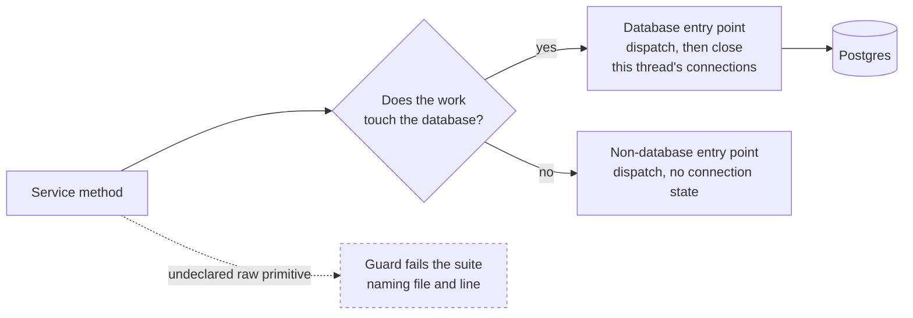

# Worker-Thread Database Connection Hygiene - Plan

## Goal Capsule

**Objective:** The AstroDash web process holds no database connection it has finished with, and a change that would reintroduce one fails the test suite instead of reaching a deployment.

**Means:** A single connection-closing seam at the infrastructure boundary that all thread-dispatched database work runs through, plus a posture guard that stops production source from dispatching thread work without declaring what kind of work it is (KTD1, KTD2).

**Product authority:** The maintainer. This is follow-up work on two of the deferred review findings from `scimma/astrodash#73`, which merged as `24dad17`. Active scope is the connection leak and the part of the layering finding that this seam touches; the PR's other four deferred findings are not in scope. Where this plan and the Product Contract disagree, the Product Contract wins; where the plan and the repository disagree, the repository wins and the plan is corrected.

**Stop conditions:** Stop and ask rather than deciding alone if the seam turns out to need reaching from the request thread (KTD6 says it must not), if the R6 scan finds a dispatch whose kind is genuinely ambiguous, if the guard cannot be made to pass without a per-file exception list beyond the seam's own module, or if any fix would change a requirement. The Docker stack is down by the maintainer's choice: ask before starting it.

**Execution profile:** Six units, each landable as its own commit, on a feature branch pushed to the `bot` remote. U5 lands after U2, U3 and U4 or it fails the suite. The maintainer opens and merges anything that goes to `upstream`.

**Open blockers:** None. Four questions are deferred to implementation and three of them are answered below as KTD2, KTD3 and KTD4.

## Product Contract

### Summary

All thread-dispatched database work moves onto one shared seam that closes the connection in the thread that opened it, which closes the nine unprotected dispatch sites in the model service and replaces the private helper the by-name service carries today. A guard test then rejects any undeclared thread dispatch in production source, so a future dispatch has to declare itself as database work or as non-database work and cannot silently leak.

### Problem Frame

Nothing in the application closes the database connection that a dispatched thread opens. Django's connection handler is keyed per thread and per context, and `asgiref.sync.async_to_sync` - which is how both view modules reach these async services - builds a fresh event loop, a fresh single-worker executor, and a fresh `contextvars` context on every call. The connection that the dispatched work opens therefore belongs to a thread and a context that no request lifecycle ever cleans up.

Measurement inside the project image, 20 requests per shape with the cycle collector disabled, shows the connection wrapper surviving the work returning, the worker thread dying, and the executor shutting down: 20 of 20 still open on the clean path, on a path that raises, and on a path whose exception is caught and held. They come back only when CPython's generational cycle collector runs, because the wrapper sits in a reference cycle. The number of Postgres backends a worker process holds is therefore governed by garbage-collection timing rather than by load or concurrency.

With the collector left at its default thresholds, which is what a deployed worker runs, 200 requests of one synthetic shape in a single process peaked at **61 simultaneously open connections**, oscillating between 10 and 61 as collections fired. That is one process under one request shape, not a capacity model: what it establishes is that a per-process peak of this size leaves no headroom under the server's default ceiling of 100 once more than one worker runs.

So the mechanism is GC-timed rather than strictly cumulative, but the magnitude is not reassuring: exhaustion is a demonstrated path, not a hypothetical one. Nothing in the deployment absorbs the slack: there is no `CONN_MAX_AGE`, no pooler and no `max_connections` tuning in the application, the compose files, or the gitops chart, so two gunicorn workers run against a single `postgres:16` replica at the server default ceiling.

One consequence has already been paid. A CI run in which all 553 tests passed still exited 1, because the test database could not be dropped: `database "test_astrodash_db" is being accessed by other users. DETAIL: There are 2 other sessions using the database.` Commit `cee0e16` closed that for the by-name seam. The model service, whose nine dispatches reach the Django ORM through the repository wired at `app/astrodash/services.py:109`, is still exposed.

### Key Decisions

- **Close the class of bug, not only the known sites.** (session-settled: user-directed - chosen over fixing the nine call sites alone: a tenth dispatch written later would leak again with nothing to catch it.) Governs R5, R7, R8, R9.

- **The seam lives at the infrastructure boundary, not in a domain module.** The model service has no Django imports today, so a domain-level home for the helper would add one to a module that is currently clean, and would deepen the open layering finding instead of easing it. (session-settled: user-directed - chosen over a shared utility module or importing the by-name service's existing helper: those keep or spread the domain layer's dependency on Django.) Governs R1, R2, R3.

- **The guard bans raw dispatch rather than detecting database access.** A static scan cannot tell which dispatched callable eventually touches the ORM, so the rule inverts: every dispatch names its own kind, and the check stays syntactic. (session-settled: user-approved - chosen over inferring database access from the call target: inference would be both unreliable and unenforceable.) Governs R5, R6, R7.

- **Removing the async layer is deferred, not rejected.** Every caller already wraps these services in `async_to_sync`, so no concurrency is being preserved and the per-call context that causes this leak is ceremony. Making the services synchronous would delete the cause rather than contain it, at the price of changing service signatures and every call site in both view modules days after they shipped. (session-settled: user-approved - chosen over doing it now: the wide refactor is not needed to close the leak.)

<!-- ce-section: work-relationships -->
### How This Work Fits Together

This plan covers two of the six findings deferred from `scimma/astrodash#73`: the worker-thread connection leak, and the slice of the layering finding that the seam's placement settles. The breakdown below is how the remaining findings are understood today, not a committed roadmap, and a later plan may revise, split or discard any of it.

- Removing the `async_to_sync` layer from these services - **depends on** this plan, which establishes where connection hygiene lives, and would **supersede** most of it by deleting the off-request dispatch entirely.
- Connection ceilings, pooling and recycling - **can proceed independently of** this plan, and **shares** its problem statement: nothing bounds connections anywhere today.
- The domain layer's remaining Django imports in the by-name service - **shares** the layering concern this plan partly settles.
- Refusal kinds enumerated in three places, the cache fail-open cost without Redis, the whole-row dedupe degradation, and the `makemigrations --check` drift gate - **can proceed independently of** this plan and of each other.
- **Still to decide:** whether any of the above is worth a branch of its own or waits for a reason to touch those files again.

### Requirements

**The seam**

R1. Thread-dispatched database work closes the connections opened in that thread when the work finishes, whether it returns or raises.

R2. The seam is owned by the infrastructure layer, and no domain service imports Django's connection machinery in order to use it.

R3. The by-name service's private `_in_db_thread` helper is replaced by the shared seam with no change to its behaviour, and the by-name regression test still passes against the replacement.

R4. All nine database dispatches in `app/astrodash/domain/services/model_service.py` run through the seam.

**Prevention**

R5. Production source under `app/` runs no work off the request thread without declaring what kind of work it is: every dispatch goes through either the database seam or an explicit non-database path. The dispatch forms this covers are `asyncio.to_thread`, `threading.Thread`, `ThreadPoolExecutor`, `ProcessPoolExecutor`, `loop.run_in_executor` and `sync_to_async`, including aliased imports of each.

R6. The non-database dispatches known today are the template-analysis calls in `app/astrodash/domain/services/template_analysis_service.py`, the inference calls under `app/astrodash/infrastructure/ml/classifiers/`, the file read at `app/astrodash/domain/services/spectrum_service.py:440`, and the WISeREP fetch at `app/astrodash/domain/services/spectrum_service.py:531`. A scan at implementation time is authoritative for the full set.

R7. The test suite fails on an undeclared dispatch in any form R5 names and reports the file and line that carries it, following the scan conventions the existing guards use in `app/astrodash/tests/test_no_osc_references.py` (`tests/`, `migrations/` and `__pycache__/` excluded).

R8. The guard's own detection patterns carry positive and negative cases for each dispatch form R5 names, as `app/astrodash/tests/test_no_version_literals.py` does for its patterns.

R9. A regression test proves that a dispatched database call leaves no open connection behind, and fails if the seam is bypassed. It exercises a real service dispatch rather than calling the seam directly, and it states the observable it checks, because a worker thread's connection handler is no longer reachable from the test thread once that thread exits.

**Accuracy of the written explanation**

R10. Docstrings that explain this failure mode say that the views reach these services through `async_to_sync`, which is what they do. Two of them currently say `asyncio.run`, at `app/astrodash/domain/services/spectrum_service.py:357` and `app/astrodash/tests/test_spectrum_by_name.py:1457`; no production module calls `asyncio.run` directly.

### Acceptance Examples

AE1. **Covers R1, R9.** **Given** a database call dispatched to a thread, **when** the work returns, **then** that thread holds no open connection.

AE2. **Covers R1.** **Given** a dispatched database call that raises, **when** the exception propagates to the caller, **then** the connection is closed anyway. Measurement showed the error paths leaking exactly as the clean path does, so this is not a redundant case.

AE3. **Covers R7.** **Given** an undeclared `asyncio.to_thread` call added to any production module, **when** the suite runs, **then** the guard test fails and names that file and line.

AE4. **Covers R5, R7.** **Given** an undeclared dispatch written with a form other than `asyncio.to_thread` -- a `ThreadPoolExecutor` submission or a bare `threading.Thread` -- **when** the suite runs, **then** the guard test fails on it as well. The leak does not care which primitive opened the thread.

AE5. **Covers R5, R6, R7.** **Given** a dispatch declared as non-database, **when** the suite runs, **then** the guard passes without an entry in a per-file exception list.

AE6. **Covers R3, R4.** **Given** the full suite run against the seam, **when** it finishes, **then** `Destroying test database` is the last line, no `OperationalError` follows it, and the run exits 0.

### Success Criteria

- The suite continues to drop its test database and exit 0, per AE6. This is a non-regression guard, not proof the fix landed: every test that touches the model service substitutes a mock for it, and nothing drives its repository through the nine dispatches, so this signal reads the same before and after R4.
- Reverting the seam makes the R9 regression test fail. That is the signal that the leak is actually fixed, because it is the only check that observes a dispatched call's connection.
- Planting an undeclared dispatch in a production module makes the R7 guard fail, so the prevention is demonstrated rather than asserted.

### Scope Boundaries

- Making these services synchronous and removing the `async_to_sync` layer. Deferred per the Key Decision above; it is the better endgame and this work does not block it.
- Connection ceilings, pooling and recycling. Nothing in the application or the chart bounds connections today, which is worth its own operational change and is not this fix.
- The rest of the layering finding. The by-name service would stop importing Django's connection machinery but still imports its cache and timezone helpers, so the finding shrinks rather than closes.
- The other deferred findings from `scimma/astrodash#73`: refusal kinds enumerated in three places, the cache fail-open cost when Redis is unreachable, the whole-row dedupe degradation, and the `makemigrations --check` drift gate.
- A `docs/solutions/` write-up of the measured mechanism. The measurement corrected a merged claim and would carry, but nobody asked for it.

### Dependencies and Assumptions

- The reclamation measured here comes from CPython's cycle collector. Verified by probe inside the project image at asgiref 3.12.1, Django 5.2.6, Python 3.13.16.
- No other production code dispatches database work off the request thread. Verified: no `threading.Thread`, `ThreadPoolExecutor`, `ProcessPoolExecutor`, `run_in_executor`, `sync_to_async` or Celery task exists in non-test source under `app/`.
- `connections.close_all()` appears exactly once in production source today, at `app/astrodash/domain/services/spectrum_service.py:372`.
- The deployment runs 2 gunicorn workers against one Postgres replica at the server default connection ceiling, per `../astrodash-k8s-gitops/apps/astrodash/values.yaml`.

### Outstanding Questions

**Answered during planning** -- the declaration mechanism (KTD2), the guard's scan shape (KTD3), and the seam module's own exemption (KTD4).

**Deferred to Implementation**

- Whether the R6 scan finds a non-database dispatch beyond the ten the dispatch census names. U4 runs that scan as its first step.

**For the maintainer**

- Whether anything should cover an **undispatched** ORM call made inside one of these async services. Such a call does not run on the request thread: `async_to_sync` submits the whole service body to a fresh single-worker executor, so Django's request-finished cleanup never sees it and it leaks exactly as the nine model-service sites do -- while carrying no dispatch primitive for the guard to find and no seam call to route it. This plan closes the dispatched paths and leaves that one open, because covering it needs a different mechanism (a connection-lifecycle hook around the service boundary), not a wider call site. KTD6 holds the line at dispatched threads only.

### Sources and Research

- `scimma/astrodash#73`, merged as `24dad17`, whose body carries the deferred findings this work draws from. Its severity claim for this finding is corrected by the Problem Frame above.
- `app/astrodash/domain/services/spectrum_service.py:350-372` - the existing `_in_db_thread` helper and the only `connections.close_all()` in production source.
- `app/astrodash/domain/services/model_service.py:129,246,251,257,272,278,287,297,321` - the nine unprotected dispatches.
- `app/astrodash/services.py:109` - where the Django-backed repository is wired into the model service.
- `app/astrodash/tests/test_no_osc_references.py` and `app/astrodash/tests/test_no_version_literals.py` - the two posture-guard precedents, one syntax-tree based with a regex fallback, one regex only.
- `app/astrodash/tests/test_spectrum_by_name.py:1449-1485` - `WorkerThreadConnectionTests`, the existing regression test for this failure mode.
- `app/astrodash_project/settings.py:141-150` - the `DATABASES` block, with no `CONN_MAX_AGE` and no `OPTIONS`.

---

## Planning Contract

**Product Contract preservation:** Product Contract unchanged. Planning added no requirement and altered no R-ID; the three technical questions it had deferred are answered below as KTD2, KTD3 and KTD4.

### Key Technical Decisions

KTD1. **The seam is a flat module at the infrastructure root, beside the existing Django repositories.** `app/astrodash/infrastructure/django_repositories.py` is itself a flat single-concern module and the infrastructure layer's only current `django.db` importer, so a sibling module is the lowest-friction fit; every consumer in this repo imports by full dotted path, and all but one `infrastructure/**/__init__.py` is empty, so there is no re-export convention to honour. (session-settled: user-directed - chosen over `infrastructure/database/`, which reads like the right home but holds the dead SQLAlchemy path reachable only through an orphaned DI module, and over `shared/`, whose stated charter is pure utilities.) Governs R1, R2, R3.

KTD2. **The declaration is a named call that owns the dispatch, not a marker comment.** The seam exposes two awaitable entry points, each of which performs the thread dispatch itself: one runs database work and closes that thread's connections, one runs non-database work. A call site awaits the seam and never spells a dispatch primitive, which is what lets the guard reject every raw primitive outside the seam module and keeps the check syntactic as the Key Decision requires. A relocated synchronous wrapper would not do: call sites would still spell `await asyncio.to_thread(wrapper, work)`, and the guard would flag all fourteen of them. A per-line exemption comment has precedent in `app/astrodash/tests/test_no_model_type_literals.py`, but a comment is pasteable and carries no behaviour. (session-settled: user-approved - chosen over the comment marker: a call is what a syntactic scan can trust.) Governs R5, R6, R7.

KTD7. **A wrong declaration is detected, not trusted.** The declaration is the only evidence that work is non-database, and nothing in a syntactic guard can check that the evidence is true: a callable that reaches the ORM through the non-database entry point would leak exactly as the nine model-service sites do today, with the guard green. The non-database entry point therefore checks, after the work returns, whether its dispatched thread opened a connection; if one is open it closes it and logs an error naming the declaring call site. Closing rather than raising keeps a misdeclaration from turning a silent leak into a failed request, and a test pins the detection so a misdeclared dispatch is visible in CI. Governs R5, R6.

KTD3. **The guard mirrors the TLS-posture guard, not the version-literal one.** `app/astrodash/tests/test_no_osc_references.py` pairs an `ast.NodeVisitor` with line patterns that remain the only check when a file does not parse, and that is the shape this needs: a dispatch is an expression, so a line pattern alone would miss aliased imports and attribute spellings. Its scan constants carry over unchanged - the root is `app/`, and `tests`, `migrations` and `__pycache__` are excluded. R5's six forms are a closed enumeration, so a dispatch mechanism arriving with a new dependency -- anyio's `to_thread.run_sync`, a task queue -- passes the guard until its pattern is added; the guard's own docstring carries that caveat so the next reader knows the list is maintained, not exhaustive. One thing does **not** carry over: that guard merges its line patterns into every file's result, whereas this one runs them only when `ast.parse` fails. A dispatch primitive appears in ordinary prose here -- `dash_classifier.py` and `transformer_classifier.py` both carry "used from async via to_thread" in a docstring -- so a merged line scan would fail on clean files that U4 is forbidden to edit. Governs R7, R8.

KTD4. **The seam's own module is exempt by path, and a test pins that exemption.** The module defining the seam must spell the primitives the guard bans. Excluding it by path keeps AE5's promise that no per-file exception list is needed for ordinary code, because the exemption covers one module named in the guard rather than a growing list. The exemption is broad inside that module, so a second helper added there could dispatch without closing and go unguarded; a test pins that the module exports only the two declared entry points. Governs R7.

KTD5. **The regression test observes the connection from inside the worker thread.** Once a dispatched thread exits, its thread-local connection handler is unreachable from the test thread, so the test records the state in the thread that opened it and asserts afterwards. It drives a real service dispatch with real repositories under `TransactionTestCase`, following `InteractiveRetentionTests` in `app/astrodash/tests/test_spectrum_by_name.py`, because a test that calls the seam directly stays green when a call site bypasses it. Governs R9.

KTD6. **The seam closes connections only on the thread it dispatched to.** Closing every connection visible in the calling thread is correct on a dispatched thread and harmful on a thread that may hold an open atomic block. Because the database entry point performs its own dispatch (KTD2), the close runs on a thread the seam created and the caller's own connections are never touched -- the guarantee is structural rather than a convention a call site could break. Planning does not extend the seam to undispatched calls. Governs R1, R2.

### High-Level Technical Design

Every off-request dispatch in production source routes through one of two declared paths, and the guard's job is to prove nothing takes the third.



### Dispatch census

Twenty-four `asyncio.to_thread` call sites exist in production source today. The split decides how much of this work is mechanical.

| Where | Sites | Kind | This plan |
|---|---|---|---|
| `app/astrodash/domain/services/model_service.py` | 9 | database, unprotected | route onto the seam (U3) |
| `app/astrodash/domain/services/spectrum_service.py` | 5 | database, already wrapped in the private helper | re-point at the shared seam (U2) |
| `app/astrodash/domain/services/spectrum_service.py` | 2 | non-database: a file read and the WISeREP fetch | declare (U2) |
| `app/astrodash/domain/services/template_analysis_service.py` | 3 | non-database: template reads | declare (U4) |
| `app/astrodash/infrastructure/ml/classifiers/` | 5 | non-database: CPU-bound inference | declare (U4) |

No production code uses `threading.Thread`, `ThreadPoolExecutor`, `ProcessPoolExecutor`, `run_in_executor` or `sync_to_async` today. R5 names them anyway so the first one to arrive arrives declared.

### Assumptions

- The Docker stack is down by the maintainer's deliberate choice, so no verification step in this plan runs until it is brought back up. Ask before doing so.
- `model_service.py` has no test module today, so U3 writes its first one rather than extending existing coverage.
- Matching the neighbouring module's idiom is the tie-break for the seam's logging and typing style, since the tree carries two live conventions for each.

### Sequencing

U1 builds the seam. U2, U3 and U4 route call sites onto it and can land in any order among themselves. U5 adds the guard **last**, because it fails the suite until every declaration from U2, U3 and U4 is in place. U6 adds the regression test, which depends only on U1 and the call sites it exercises.

---

## Implementation Units

### U1. The shared connection-hygiene seam

**Goal:** One module at the infrastructure boundary owns running work off the request thread, with a database path that closes what it opened and a non-database path that declares itself.

**Requirements:** R1, R2. Implements KTD1, KTD2, KTD6.

**Dependencies:** none.

**Files:**
- `app/astrodash/infrastructure/db_threads.py` (create)
- `app/astrodash/tests/test_db_threads.py` (create)

**Approach:**
1. Copy the close logic of `_in_db_thread` from `app/astrodash/domain/services/spectrum_service.py` into the new module, wrapped so the entry point performs the dispatch itself and the close runs on the thread it dispatched to (KTD2, KTD6). Copy rather than move: the by-name call sites still reference the private helper until U2 re-points them, so a move would leave U1 unable to land on its own. Carry the docstring's explanation of why the close is needed, correcting `asyncio.run` to `async_to_sync` per R10.
2. Add the non-database entry point, which dispatches the same way, does no connection setup, and after the work returns applies KTD7's detection: if its thread holds an open connection the declaration was wrong, so close it and log an error naming the call site.
3. Both are awaitable module-level functions, matching how this tree exposes stateless helpers; no class, factory or context manager. A caller awaits the seam and never spells a dispatch primitive.

**Patterns to follow:** `app/astrodash/infrastructure/django_repositories.py` for a flat single-concern infrastructure module and its logger idiom; `app/astrodash/infrastructure/wiserep/client.py` for a module docstring that explains the failure mode it avoids; `app/astrodash/infrastructure/storage/wiserep_spectrum_repository.py` for free functions beside a class.

**Test scenarios:**
- The database entry point runs its work on a thread other than the caller's, and closes the connection on that thread rather than the caller's. This is the scenario that pins KTD6's guarantee as structural; the normal-return close itself is already pinned by the relocated test U2 re-points.
- Covers AE2. Database work that raises propagates the exception and still leaves no open connection.
- The database entry point returns the wrapped callable's return value unchanged, and forwards positional and keyword arguments.
- Non-database work runs and returns its value, and opens no connection of its own.
- A callable misdeclared as non-database, which touches the ORM, is detected: the connection is closed and an error naming the call site is logged (KTD7).
- The module exports only the two declared entry points, so KTD4's path exemption cannot quietly cover a third.

**Verification:** The new module's tests pass, and the by-name suite still passes against the moved helper.

### U2. Route the by-name service onto the seam

**Goal:** The by-name service stops carrying its own connection helper and stops importing Django's connection machinery, which is the layering half of KTD1.

**Requirements:** R2, R3, R10, and the two non-database declarations in R6.

**Dependencies:** U1.

**Files:**
- `app/astrodash/domain/services/spectrum_service.py` (modify)
- `app/astrodash/tests/test_spectrum_by_name.py` (modify)

**Approach:**
1. Delete the private `_in_db_thread` and import the seam's database entry point in its place; re-point all five database dispatches.
2. Declare the file read and the WISeREP fetch through the non-database entry point.
3. Drop the now-unused `django.db.connections` import, leaving the service's remaining Django imports alone - the cache and timezone helpers are outside this plan's scope.
4. Restructure the existing `WorkerThreadConnectionTests`, which goes vacuous if it is merely re-pointed: it calls the helper synchronously on a thread it owns and then reads the connection state in that same thread, so once the seam does its own dispatch the test thread never opens a connection and the assertion passes while observing nothing. Capture Django's connection wrapper inside the dispatched work, drive the seam through `async_to_sync`, and assert the captured wrapper's connection is closed after the dispatch returns. Correct its docstring's `asyncio.run` claim per R10.
5. Delete the private helper only after the five call sites are re-pointed, so the file never holds two copies.

**Execution note:** `WorkerThreadConnectionTests` is the canary for this move, but its observation mechanism has to change because the seam now owns the dispatch. What it pins is unchanged; how it observes is not. A version of it that still passes without being restructured is not evidence.

**Test scenarios:**
- The existing by-name tests pass unchanged against the relocated seam, including the retention and single-flight cases that drive real threads.
- Covers AE6. A full suite run drops the test database with no `OperationalError` after it.
- No module under `app/astrodash/domain/` imports `django.db` for connection handling once this unit lands.

**Verification:** The by-name tests pass, and the service no longer references Django's connection handler.

### U3. Route the model service's nine dispatches, and give that path its first test

**Goal:** The nine unprotected database dispatches close their connections, and a test can tell whether they do - which today nothing can.

**Requirements:** R4, and R9 for the model-service path.

**Dependencies:** U1.

**Files:**
- `app/astrodash/domain/services/model_service.py` (modify)
- `app/astrodash/tests/test_model_service_connections.py` (create)

**Approach:**
1. Route all nine dispatches through the seam's database entry point, leaving each repository call and its arguments otherwise untouched.
2. Write the module's first test, constructing the real service with a real `DjangoModelRepository` and driving it through its public async methods under `TransactionTestCase`, as `InteractiveRetentionTests` does for the by-name path.
3. Keep model storage stubbed; the subject is connection hygiene on the dispatch, not file storage.

**Execution note:** Write the failing connection test before routing the nine sites, so the coverage gap the review found is closed by evidence rather than by assertion.

**Test scenarios:**
- Covers AE1. One case per public method that dispatches, each asserting no open connection on the dispatched thread afterwards: `upload_model`, `save_model`, `get_model`, `list_models`, `delete_model`, `list_models_by_owner` and `update_model_metadata`. Seven methods carry the nine sites, so anything less leaves some of them with no bypass detection at all.
- Covers AE2. A repository call that raises still leaves no open connection behind.
- Reverting any one of the nine call sites to a raw dispatch makes the case covering that method fail. The claim holds for all nine only because every method that carries one is driven.

**Verification:** The new test fails against the unrouted service and passes once the nine sites are routed.

### U4. Declare the remaining non-database dispatches

**Goal:** Every off-request dispatch in production source states which kind of work it is, so the guard in U5 has nothing left to flag.

**Requirements:** R5, R6.

**Dependencies:** U1.

**Files:**
- `app/astrodash/domain/services/template_analysis_service.py` (modify)
- `app/astrodash/infrastructure/ml/classifiers/dash_classifier.py` (modify)
- `app/astrodash/infrastructure/ml/classifiers/transformer_classifier.py` (modify)
- `app/astrodash/infrastructure/ml/classifiers/oned_cnn_classifier.py` (modify)
- `app/astrodash/infrastructure/ml/classifiers/latent_classifier.py` (modify)

**Approach:**
1. Route the three template-analysis dispatches and the five classifier dispatches through the non-database entry point.
2. Change nothing else in these files. They are touched only because they dispatch, and a wider edit here is the drive-by diff the project's conventions forbid.
3. Re-run R6's scan as the unit's first step; if it finds a dispatch this plan did not name, declare it here and note the addition.

**Test scenarios:**
- Classification through each classifier returns the same result as before the declaration, proving the wrapper is transparent.
- Template analysis returns the same templates and validation outcomes as before.
- Test expectation beyond the above: none -- these are transparent call-shape changes, and the classifier and template suites already cover the behaviour.

**Verification:** The existing classifier and template-analysis tests pass unchanged, and no undeclared dispatch remains outside the seam's own module.

### U5. The posture guard

**Goal:** An undeclared dispatch fails the suite with the file and line that carries it, so the next person to write one finds out from CI.

**Requirements:** R5, R7, R8. Implements KTD3, KTD4.

**Dependencies:** U2, U3, U4 - the guard is red until every declaration is in place.

**Files:**
- `app/astrodash/tests/test_dispatch_posture.py` (create)

**Approach:**
1. Walk `app/` for `*.py`, excluding `tests`, `migrations` and `__pycache__`, and excluding the seam's own module by path.
2. Flag an undeclared dispatch through a syntax-tree visitor. Run the line patterns **only** when `ast.parse` fails, which is where this guard departs from the one it mirrors: that one merges its line hits into every file, and here that would flag `dash_classifier.py` and `transformer_classifier.py`, whose docstrings mention `to_thread` in prose and which U4 forbids editing. Keep its `file:line: what` report format.
3. Cover every form R5 names, including an aliased import of the primitive rather than only the dotted spelling.
4. Carry a second test class of positive and negative cases for the patterns themselves, as both existing guards do.

**Test scenarios:**
- Covers AE3. An undeclared `asyncio.to_thread` call in a production module is flagged with its file and line.
- Covers AE4. An undeclared `ThreadPoolExecutor` submission and a bare `threading.Thread` are each flagged.
- An aliased import of a banned primitive is flagged.
- Covers AE5. A dispatch through either seam entry point is not flagged, and needs no per-file exception.
- The seam's own module is not flagged, pinned by path rather than by pattern.
- A file that does not parse falls back to the line patterns rather than passing silently.
- A docstring or comment mentioning a dispatch primitive in prose is not flagged, pinned against the two classifier modules that actually carry one.
- The live scan over `app/` reports no offender.

**Verification:** The guard passes on the tree as this plan leaves it, and fails when a raw dispatch is planted in any production module.

### U6. The bypass regression test for the by-name seam

**Goal:** The seam's guarantee is pinned on a real dispatch path, not on a direct call to the helper.

**Requirements:** R9, R10. Implements KTD5.

**Dependencies:** U1, U2.

**Files:**
- `app/astrodash/tests/test_spectrum_by_name.py` (modify)

**Approach:**
1. Add a case that drives the by-name service through a real dispatch with real repositories and asserts the dispatched thread holds no connection afterwards, recording the observation inside that thread.
2. Keep the existing direct-call test; it pins the seam's own contract, and this one pins the call site's use of it.

**Test scenarios:**
- Covers AE1. A by-name lookup that reaches storage leaves no open connection on the dispatched thread.
- Replacing the seam call at that site with a raw dispatch makes this test fail.

**Verification:** The test passes, and fails when the call site under test bypasses the seam.

---

## Verification Contract

Run the full suite inside the container. `run/astrodash.test.sh` does not work, independently of this plan: it targets a service `app_dev` that exists in neither compose file and omits the dev overlay.

```
docker compose --file docker/docker-compose.yml --file docker/docker-compose.dev.yaml \
  --env-file env/.env.default --env-file env/.env.dev --profile full_dev \
  exec -T app bash -c 'python manage.py test astrodash.tests users.tests -v 1 --noinput'
```

Gates:

- **The run exits 0 in CI.** Locally one failure is expected and is not a regression: `astrodash.tests.test_model_access.EntryLinkTokenTests.test_committed_signing_key_refuses_to_mint` asserts the committed `django-insecure-` default while `env/.env.dev` supplies a real `SECRET_KEY`. It fails identically on `main`.
- **`Destroying test database` is the last line, with no `OperationalError` after it.** Read the exit status, not the tail - this defect's first symptom was a green suite that still exited 1.
- **The guard fails on a planted raw dispatch** in a production module, and passes once it is removed.
- **The two new connection tests fail when their call site bypasses the seam.** A test that cannot fail proves nothing here.
- Changed Python formatted with `black`; type hints on new signatures; Google-style docstrings.
- Do not run `makemigrations`. `SpectrumRecord.id` uses a lambda default that it cannot serialize, so it reports a spurious pending migration.

The Docker stack is currently down at the maintainer's request. Ask before bringing it up for verification.

---

## Definition of Done

- Every requirement R1 through R10 is met, and every acceptance example AE1 through AE6 has a test that enforces it.
- No module under `app/astrodash/domain/` imports Django's connection machinery.
- No undeclared off-request dispatch remains in production source under `app/`, and the guard proves it.
- The full suite exits 0 in CI and drops its test database cleanly.
- Each new test has been seen to fail for the right reason before it passed.
- No abandoned approach is left in the diff: no unused seam entry point, no dead import left by the helper's move, no commented-out call site.
- The Product Contract is unchanged by implementation; a change discovered to be necessary goes back to the maintainer rather than into this file.
