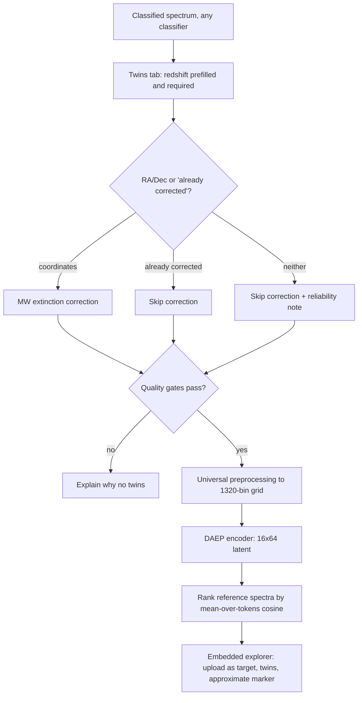
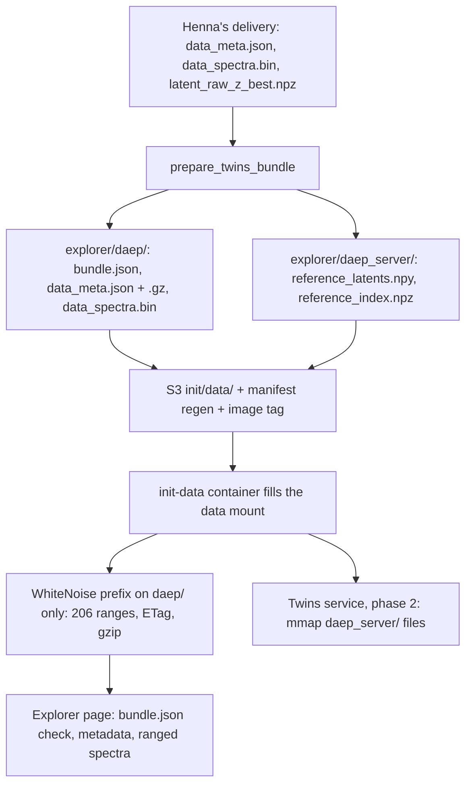
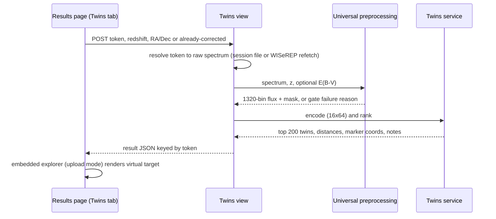

# DAEP Spectral Twins Explorer - Plan

## Goal Capsule

- **Objective:** Anyone visiting AstroDash can explore Henna Abunemeh's DAEP latent space of 39,296 WISeREP supernova spectra and its precomputed twins (phase 1), and then find DAEP twins for their own spectrum after any classification (phase 2).
- **Means:** Port Henna's latent explorer into AstroDash and serve her prepared data bundle from the data mount (KTD1, KTD2); in phase 2, run her Universal preprocessing and the DAEP encoder already on the mount against the uploaded spectrum (KTD5, KTD6).
- **Product authority:** This plan covers both phases. Phase 1 (U1-U4) ships and is validated on its own; phase 2 (U5-U10) builds on it and retires DASH Twins. It supersedes the direction in `docs/brainstorms/2026-07-06-daep-twins-embedding-requirements.md`, which assumed repointing the existing DASH Twins UI. The Product Contract wins on behavior; KTDs win on mechanism.
- **Open blockers:** None for planning or for phase 1 implementation. The phase 1 DEV deploy waits on Henna's OK to publish before her paper; phase 2 implementation waits on her OK for the preprocessing port (see Dependencies / Assumptions).
- **Stop conditions:** Stop and ask if the U1 alignment check shows the reference latents cannot be matched row-for-row to `data_meta.json`, or if U9 parity fails beyond tolerance after preprocessing is confirmed faithful.
- **Execution profile:** Two PRs, one per phase, each from a `bot` branch to `scimma/astrodash` per the repo's machine-account workflow. Data files reach S3 through the maintainer; DEV/PROD rollouts follow `docs/solutions/workflow-issues/astrodash-tag-driven-release-and-deploy-flow.md`.

---

## Product Contract

### Summary

Phase 1 adds a public Spectral Twins explorer page to AstroDash, ported from Henna's DAEP dashboard into AstroDash's look and driven by her precomputed data bundle; the existing DASH Twins feature keeps working alongside it.
Phase 2 adds a Twins tab to every classification result: the app preprocesses and DAEP-encodes the uploaded spectrum, finds its twins in her latent space, and shows them in the embedded explorer; DASH Twins is then retired.

### Problem Frame

AstroDash's twins feature borrows the DASH CNN's penultimate-layer activation as its embedding, a side effect of a classifier rather than a representation built to measure spectral similarity, and it is reachable only after a DASH classification.

Henna Abunemeh (UIUC) has trained a DAEP (Perceiver encoder plus diffusion decoder) on 39,296 deredshifted WISeREP spectra from 16,411 objects, purpose-built for full-spectrum similarity, and built a rich dashboard around it: a UMAP latent map, twin search, spectra with DAEP reconstructions, and a metric panel.
Today that work is visible only to people who can run `serve.py` on the UIUC cluster through an SSH tunnel.

Henna's delivery (`../Dered36_5`, plus `../latent_explorer_shell_Universal_website.html`, byte-identical to the bundle's `latent_explorer.html`, and `../Preprocess_Universal.py`) is browse-only: every twin and map coordinate is precomputed, and nothing embeds a new spectrum.
She suggested getting the data and twins browsing working first, then working out user uploads.

### Key Decisions

- **One plan, two phases.** Browse explorer first, upload twins second, with the end state designed up front. (session-settled: user-directed - chosen over scoping this plan to the browse explorer alone: the user wanted the end state designed together.) Governs R1-R26.
- **DASH Twins coexists in phase 1 and is retired in phase 2.** Users keep upload-to-twins until the DAEP path replaces it. (session-settled: user-approved - chosen over permanent coexistence and over replacing it in phase 1: avoids both a twins gap and two competing twin finders.) Governs R12, R24.
- **Public from day one.** No access gating on the explorer. (session-settled: user-directed - chosen over gated-first-then-public and DEV-only: the user wants it openly available.) Governs R1.
- **Adopt the UI into AstroDash rather than serve Henna's HTML verbatim.** We own the ported page; only her data regenerations drop in without code changes, and her later UI changes are ported by hand. (session-settled: user-directed - chosen over a drop-in bundle served nearly verbatim and over merging into the DASH Twins page.) Governs R2, R10, R11.
- **Keep her core explorer, spectra with reconstructions, and download; drop the inert model selector.** (session-settled: user-directed - chosen over keeping the "Supernova only / Multi-Object" placeholder, which is not wired to anything.) Governs R3-R6.
- **Serve the reference bundle as delivered (Approach A).** The page reads her metadata and spectra files from the data mount, and phase 2 returns an upload's twins as positions in that same reference set. (session-settled: user-approved - chosen over an app-owned reference store with a twins API and over linking out to a Henna-hosted explorer: least new machinery, and regeneration stays a file swap.) Governs R7-R9, R19.
- **Phase 2 twins are available after any classification.** DAEP does not depend on the classifier, so the DASH-only gate has no reason to survive. (session-settled: user-approved - chosen over the DASH-only gate, a direct upload on the explorer page, and both entry points.) Governs R14.
- **Upload twins appear in a Twins tab on the results page.** The explorer is embedded there in upload mode. (session-settled: user-directed - chosen over navigating to the standalone explorer page with a session-bound token and over a shareable result link.) Governs R19.
- **The Twins tab asks for the redshift.** A small form makes redshift required and prefilled, so twins work after no-redshift classifiers too. (session-settled: user-approved - chosen over offering twins only when a redshift is known and over silently using whatever redshift exists.) Governs R26.
- **Milky Way extinction coordinates are optional, with a visible reliability note when absent.** (session-settled: user-approved - chosen over requiring coordinates and over never correcting: keeps quick uploads possible while matching the reference build when coordinates exist.) Governs R20-R22.
- **Approximate map placement is acceptable for uploads.** The twins list is the real answer, and the map stays exactly as Henna built it. (session-settled: user-approved - chosen over waiting for a transform-capable UMAP refit and over no map placement.) Governs R19.
- **Phase 2 uses the reference set's own distance metric.** Twins of an upload are ranked by the same mean-over-tokens cosine distance that produced the precomputed twins, so upload twins and browse twins are comparable. Governs R18.
- **No guard against non-supernova uploads.** DAEP was trained only on supernovae; a non-SN upload still gets its nearest supernovae, with distances shown so a poor match is visible. Governs R19.

### Requirements

**Phase 1 - Explorer page and access**

- R1. The explorer is a public AstroDash page with its own URL and a navigation entry, reachable without login and without classifying anything.
- R2. The page uses AstroDash's look and site chrome and is named as a DAEP-based spectral twins explorer (working name "Spectral Twins (DAEP)"), distinct from "DASH Twins".

**Phase 1 - Explorer behavior (ported from Henna's dashboard)**

- R3. A UMAP latent map of all reference spectra supports clicking a point to make it the target, coloring by raw, canonical, or broad type, and highlighting the target's top N twins.
- R4. Users can choose a target by text search, by supernova, and by individual observation, and see a top-k neighbor table with "exclude same SN" and "one observation per twin SN" filters.
- R5. A spectra panel overlays the target and its top N twins, each with its DAEP reconstruction, alongside a metric panel switchable between spectral RMSE and cosine similarity, with stack and 2x2 layouts.
- R6. A download action saves the current target and its twins (metadata and map coordinates) to a file.
- R7. Twins and distances shown for reference spectra are Henna's precomputed values; the page does not recompute them.

**Phase 1 - Reference data bundle**

- R8. The reference data comes from Henna's delivered bundle (metadata file plus binary spectra file) and reaches deployments through the same data-mount delivery path as other explorer data.
- R9. Spectra are fetched on demand when a target is selected, not downloaded in full on page load.
- R10. The page checks that a bundle matches the format it was built for and shows a clear error on a mismatch instead of rendering wrong data.
- R11. Replacing the bundle with a regeneration in the same format requires no code change.

**Phase 1 - Coexistence and deployment**

- R12. DASH Twins behaves exactly as today throughout phase 1.
- R13. The explorer works in the DEV and PROD Kubernetes deployments and in the local compose profiles.

**Phase 2 - Entry point and pipeline**

- R14. A Twins tab is offered on the results page after a classification by any classifier, using the spectrum the user already supplied.
- R26. The Twins tab asks for a redshift, required and prefilled from the user's input, the WISeREP record, or DASH's estimate; a DASH-estimated value is marked as estimated and its results carry a reliability note.
- R15. The uploaded spectrum is preprocessed with Henna's Universal preprocessing (WISeREP path; SASSAFRAS handling removed) so it lands on the same 1320-bin rest-frame grid, masking, and normalization as the reference set.
- R16. The preprocessed spectrum is embedded by the encoder of the same DAEP model that produced the reference set (the `Dered36_5` best checkpoint); the diffusion decoder is not run.
- R17. The model, its weights, and any preprocessing data files load from the data mount, never from paths baked into the code.
- R18. An upload's twins are the nearest reference spectra by the reference set's mean-over-tokens cosine distance.

**Phase 2 - Presentation**

- R19. Results appear in the Twins tab, which embeds the explorer with the upload as the target: its twins appear in the neighbor table, map highlights, and spectra overlay with distances shown, and its own map marker sits at an approximate position derived from its nearest twins, labeled as approximate. An upload that is itself a reference spectrum sits at that spectrum's own map position, with a note saying so.
- R20. Before finding twins, the user can enter the object's RA/Dec or state that the spectrum is already Milky Way extinction-corrected; RA/Dec is prefilled when the spectrum came from the WISeREP by-name lookup.
- R21. When coordinates are given, the upload is extinction-corrected the way the reference set was.
- R22. When neither coordinates nor an "already corrected" statement is given, or the correction cannot be applied, twins are still found without correction and the results carry a visible note that they may be less reliable.
- R23. An upload that fails the reference set's quality gates (missing redshift, redshift above 3, less than 1000 A of rest-frame coverage, or too few valid bins) gets a plain explanation of why twins cannot be found, and no twins.

**Phase 2 - Retirement and verification**

- R24. When phase 2 ships, the DASH Twins page, its search, and its DASH-embedding explorer artifacts are removed, and existing DASH Twins links lead to the new explorer.
- R25. Re-processing a sample of reference spectra from their original WISeREP files through the app's phase 2 path reproduces their stored DAEP latents and top twins within an agreed tolerance.

### Key Flows

- F1. Browse the reference explorer (phase 1)
  - **Trigger:** A visitor opens the explorer from the navigation.
  - **Steps:** The map loads; the visitor searches for or clicks a supernova; the neighbor table, twin highlights, and spectra overlay update for that target; the visitor adjusts filters or N, then optionally downloads the selection.
  - **Covered by:** R1, R3-R7, R9
- F2. Find twins for an upload (phase 2)
  - **Trigger:** A user has classified a spectrum with any classifier and opens the Twins tab.
  - **Steps:** The user confirms or enters the redshift, and optionally RA/Dec or "already corrected"; the app checks quality gates, preprocesses, and embeds the spectrum; it ranks reference twins; the embedded explorer shows the upload as target.
  - **Outcome:** Twins, distances, an approximate map marker, and any reliability note, or an explanation of why twins cannot be found.
  - **Covered by:** R14-R23, R26

### Acceptance Examples

- AE1. **Covers R20, R21.** Given a spectrum fetched by name from WISeREP, when the user opens the Twins tab and finds twins, then RA/Dec is prefilled, the upload is extinction-corrected, and no reliability note appears.
- AE2. **Covers R22.** Given a file upload with redshift but no coordinates and no "already corrected" statement, when the user finds twins, then twins are shown with a note that the result may be less reliable without Milky Way extinction correction.
- AE3. **Covers R23.** Given an upload whose rest-frame coverage on the 3200-9800 A grid is under 1000 A, when the user finds twins, then no twins are shown and the message says the spectrum covers too little of the model's wavelength range.
- AE4. **Covers R14.** Given a spectrum classified with `1dCNN_z` (not DASH), when the results page renders, then the Twins tab is offered.
- AE5. **Covers R10.** Given a regenerated bundle whose format the page does not recognize, when a visitor opens the explorer, then the page shows a data-format error instead of a map.
- AE6. **Covers R19.** Given an upload whose twins are found, when the embedded explorer shows them, then the upload's map marker is labeled approximate and the neighbor table lists its twins with distances.
- AE7. **Covers R26.** Given a file upload classified with `1dCNN_noz`, when the user opens the Twins tab, then the redshift field is empty and required, and twins cannot be requested until a value is entered.
- AE8. **Covers R26.** Given a DASH classification without a known redshift, when the user opens the Twins tab, then the redshift is prefilled with DASH's estimate, marked as estimated, and the results carry a reliability note.

### Success Criteria

- Phase 1: Henna inspects the explorer on astrodash-dev.scimma.org and confirms it works; PROD follows her sign-off as a separate step.
- Phase 2: the R25 parity check passes, and Henna confirms upload twins look right on DEV before PROD.
- No regression in classification, and none in DASH Twins during phase 1.

### Scope Boundaries

- The "Supernova only / Multi-Object" model selector and any multi-object or SASSAFRAS-trained model.
- A transform-capable UMAP refit or exact placement of arbitrary uploads on the map (approximate placement per R19).
- A direct "add your spectrum" upload on the explorer page itself; phase 2 enters only from classification results.
- An app-owned reference store or twins API for reference spectra (Approach B), unless page weight proves a problem.
- Serving the DAEP diffusion decoder or generating new reconstructions; reconstructions come from the bundle, and uploads show none.
- Batch-mode twins, REST API access to twins, and Henna's research diagnostics (density KDEs, unsupervised clustering, twin-distance diagnostics in the bundle).
- Classifier changes of any kind.

### Dependencies / Assumptions

- Henna and her advisor are comfortable with the latent space and twins being public before her paper appears. Confirm with Henna before the phase 1 DEV deploy, since astrodash-dev.scimma.org is publicly reachable.
- Phase 2 implementation is gated on Henna's OK for a single-spectrum port of `Preprocess_Universal.py` with SASSAFRAS removed, and on agreeing that AstroDash maintains that port when her pipeline changes.
- Henna's bundle is stable enough that regenerations keep the same format; a format change means a page update (R10).
- The public page downloads about 73 MB of metadata (much less compressed) before the map draws, comparable to today's DASH Twins payload; this is accepted for phase 1, with no special mobile support.
- File uploads are assumed to be in air wavelengths and Angstroms, since the upload form does not collect wavelength units or medium. By-name WISeREP spectra use the units, medium, and extinction-corrected flag from their WISeREP record, as the reference build did.

### Sources / Research

- Henna's delivery: `../Dered36_5` (`latent_explorer.html`, `data_meta.json`, `data_spectra.bin`, `serve.py`, `best_ckpt.pt`, `latent_raw_z_best.npz`, `cfg_used.json`, `run_summary.txt`), `../Preprocess_Universal.py`, and her April design notes in `../Twinsanity/latent_explorer_brainstorm.md`.
- `data_meta.json` holds `N=39296`, `K=50`, `W=660`, per-spectrum UMAP coordinates `Y`, top-50 `nbrs`/`dists` (with `nbrs[i][0] == i`), metadata, and a 660-point `wave` grid (3202.5 A, step 10 A); it has no format or version field. `data_spectra.bin` is exactly `N * 9 * W` bytes: per row, flux float32, reconstruction float32, mask uint8.
- Henna's generator (`../Twinsanity/WiserepData/TwinsVisual_Wiserep.py`, `compute_full_latent_distance`) unit-normalizes each of the 16 latent tokens, flattens, and divides the dot product by 16; distance is `1 - s`. The 660-bin display grid is a stride-2 subsample of the 1320-bin model grid (`spec_stride`). The UMAP used `n_neighbors=15, min_dist=0.1, metric="precomputed"`; no fitted reducer was delivered.
- `latent_raw_z_best.npz` holds `z` (39296, 16, 64) float32 plus `ds_idx` and `orig_meta_idx` index arrays.
- `Preprocess_Universal.py` requires redshift and, by default, Milky Way extinction correction from RA/Dec via SFD dust maps (`DEFAULT_REQUIRE_MW_EXTINCTION = True`); spectra failing it were excluded from the reference set.
- Prior direction: `docs/brainstorms/2026-07-06-daep-twins-embedding-requirements.md`.

---

## Planning Contract

**Product Contract preservation:** changed: R14 and R19 now name the Twins tab on the results page; R19 adds exact placement for uploads that are themselves reference spectra; R26 added (redshift on the Twins tab); AE7, AE8 added; F2 trigger updated; the Henna confirmation moved before the DEV deploy; the model-code dependency and the brainstorm's open questions resolved by research (encoder already on the mount, latent file and display grid identified); the units and medium assumption narrowed to file uploads - all confirmed by the user during planning or following from a confirmed decision.

### Key Technical Decisions

- KTD1. **Serve the bundle with WhiteNoise, registered on the bundle directory under its own URL prefix.** WhiteNoise 6.9.0 is already in the middleware stack (`app/astrodash_project/settings.py:99`) and returns single-range 206 responses, ETags, and precompressed `.gz` siblings for files it has indexed; Django's `FileResponse` does none of these, and DEV/PROD route traefik straight to gunicorn with no nginx. A small `WhiteNoiseMiddleware` subclass adds `{data_dir}/explorer/daep/` via `add_files` at startup, which tolerates a missing directory in CI. Only browser-facing files live there; server-only artifacts sit in `{data_dir}/explorer/daep_server/`, which is never registered, so the raw latents are not published. Rejected: a hand-written Range view (re-implements tested code) and an nginx sidecar in the chart (new infrastructure in the gitops repo for one feature). Governs R8, R9, R13.
- KTD2. **A bundle preparation command turns Henna's delivery into a publishable bundle.** `prepare_twins_bundle` validates her files, then writes: a descriptor `bundle.json` (integer `schema`, `bundle_id` = SHA-256 of `data_meta.json`, `N`, `K`, `W`, file sizes, encoder SHA-256), a precompressed `data_meta.json.gz`, and two server-only files in `daep_server/`: `reference_latents.npy` (per-token unit-normalized, flattened float32, row-aligned to `data_meta.json` via `orig_meta_idx`/`ds_idx`) and `reference_index.npz` (row-aligned float32 `Y`, fixed-width `spec_id` and `sn`, and the `bundle_id`). The maintainer runs it before uploading to S3. This makes R10 checkable and R11 a data release (S3 upload, manifest regeneration, image tag) rather than a code change. Governs R10, R11, R18.
- KTD3. **The page validates the descriptor before drawing anything.** It loads `bundle.json` first, refuses unknown `schema` values, cross-checks `N`/`W` against the metadata and the spectra file size (from `Content-Range`), and appends `bundle_id` as a cache-busting query on every data URL so a mid-session regeneration cannot mix rows. Any non-206 spectra response is aborted before its body downloads. The schema constant is an integer so `test_no_version_literals.py` stays quiet. Governs R10.
- KTD4. **One ported explorer in two modes.** Henna's JS is ported into a template partial shared by a standalone page (extends `base_site.html`, browse mode) and a chrome-less embedded view for the results-page iframe (upload mode, `@xframe_options_sameorigin`, following `explorer/dash_twins.html`). Upload mode adds a virtual target that is not a reference row and leaves browse behavior unchanged. While the upload is the target, the target selectors read "Your spectrum (name)" until a reference row is chosen. A "Your spectrum" button beside the selectors, shown only in upload mode, returns to it. RMSE for the upload uses its 660-bin flux and mask with the same common-valid-bin rule as references, and the reconstruction trace is omitted. The upload marker uses a distinct symbol with its own legend entry and is excluded from color-by-type groups and click-to-target. Plotly stays pinned at 2.30.0 from the CDN, as in `dash_twins.html:7`. Governs R1-R7, R19.
- KTD5. **The twins service ranks against memory-mapped reference latents.** It memory-maps `reference_latents.npy` (161 MB, shared through the page cache by both gunicorn workers under the 1536Mi pod limit) and `reference_index.npz` for coordinates, `spec_id`, and `sn`, and never parses the 73 MB `data_meta.json` (about 205 MB of Python objects per worker). It scores `X @ q / 16` for a token-normalized query, returns the top 200 with distances, and leaves the explorer's filters to the client. It refuses to rank when the descriptor's `bundle_id` or encoder hash does not match what is loaded, because a mismatch yields wrong twins with no error. Governs R16, R18.
- KTD6. **Port Henna's preprocessing for a single spectrum, keeping her constants.** The WISeREP branch of `Preprocess_Universal.py` becomes a vendored, attributed module with its grid, telluric ranges, gap masking, P90 normalization, quality gates, and CCM89/SFD correction unchanged; batch I/O, plotting, pandas, deduplication, and SASSAFRAS are dropped. The SFD map location comes from a new pydantic field (default `{data_dir}/dustmaps`) instead of her hardcoded cluster path. New pinned dependencies: `specutils`, `dust_extinction`, `dustmaps`. The existing `numpy.interp` latent preprocessing in `data_processor.py` is left alone; it serves the `latent_*` classifiers. Governs R15, R17, R21-R23.
- KTD7. **Reuse the encoder already on the mount.** `latent_z_encoder_path` points at Henna's `best_ckpt.pt` (etag match, verified in research). The checkpoint-loading steps in `latent_classifier.py:94-101` move into a shared loader used by both the latent classifiers and the twins service. Governs R16, R17.
- KTD8. **Per-classification tokens carry the twins input.** At classification time the results view stores the raw input (the uploaded file already kept in `classify_uploaded_file`, or the WISeREP `source_spectrum_id`), redshift and its provenance, object name, and RA/Dec under a fresh token, in a session dict capped at the five most recent. The Twins tab posts that token, so two tabs cannot mix results; an expired token returns "classify again". Twins always start from the raw spectrum, not the classifier-trimmed one. Governs R14, R26.
- KTD9. **The Twins tab is not a model surface.** It renders for every successful classification, including user-uploaded and access-gated models, independent of `SURFACES` and `model_access_required`, because DAEP does not depend on the classifier. Its routes carry no classifier identity. Batch results and the REST API are unchanged. Governs R14.
- KTD10. **Upload results use the bundle's display grid and its own exact-match path.** The server returns upload flux and mask stride-2 subsampled to the 660-bin grid, with no reconstruction. When the upload's WISeREP `spec_id` exists in the bundle, the marker uses that row's exact coordinates with a note, and "exclude same SN" matches on the object name; otherwise the marker is the similarity-weighted mean of the top-10 twins' coordinates. Governs R19.
- KTD11. **Carry RA/Dec and spectrum metadata through the WISeREP lookup.** Resolve `Obj. RA`/`Obj. DEC`, `WL Units`, `WL Medium`, and `Extinction-Corrected` in `selection.py`, add optional fields to `SpectrumCandidate`, keep old stored records readable, and bump the candidate cache prefix to `wiserep:candidates:v3:`. Henna's preprocessing reads all five, so a by-name spectrum without them would be unit-converted, air-converted, or extinction-corrected differently from its reference build, and would fail U9 parity. The KTD8 token carries them, and the Twins tab prefills "already corrected" from the flag. Governs R20, R21, R25.
- KTD12. **Retire DASH Twins by route.** `/classify/twins/` redirects permanently to the new explorer; `/classify/twins/data/` and `/classify/twins/search/` return 410. The DASH classifier keeps its outputs; only the session embedding stash, surface, routes, templates, service, nginx shortcuts, and manifest entries go. Follow the pinned-absence test pattern of `docs/plans/2026-10-16-0734-feat-retire-transformer-model-plan.md`. Governs R24.

### High-Level Technical Design

Bundle publication and serving (phase 1):

Find twins for an upload (phase 2):

Explorer modes:

| Mode | Where | Target source | Twins source | Spectra |
|---|---|---|---|---|
| Browse | Standalone public page | Reference row | Precomputed `nbrs`/`dists` | Ranged bin rows with reconstructions |
| Upload | Results-page iframe | Virtual target from the token's result; reference rows after a click | Server top-200 for the upload; precomputed for reference rows | Upload flux on 660 grid, no reconstruction; reference rows as in browse |

### Assumptions

- WhiteNoise serves a `.gz` sibling for files registered through `add_files` when the client accepts gzip. Verify in U2; if it does not, pre-gzip with explicit `Content-Encoding` in the same prefix handler.
- The `ds_idx`/`orig_meta_idx` arrays in `latent_raw_z_best.npz` map latent rows to `data_meta.json` rows. U1 verifies this by recomputing a sample of `dists` from the latents with the KTD5 metric; a mismatch is a stop condition.
- The data-mount PVC (5Gi, about 0.37 GB used) has room for the bundle (about 0.35 GB with `.gz`), the latents (161 MB), and the SFD maps (about 130 MB).

### Sequencing

Phase 1: U1, then U2, then U3, then U4. Phase 2 starts after phase 1 is on DEV: U5 and U6 in parallel, U7 after U6, U8 after U5 and U7, U9 after U8, U10 last.

### Risks

| Risk | Mitigation |
|---|---|
| 73 MB metadata ties up one of two sync gunicorn workers per slow client | Precompressed `.gz` cuts transfer several-fold (KTD1); watch DEV, and Approach B stays the documented escape hatch |
| Preprocessing port drifts from Henna's reference build | Vendored constants unchanged (KTD6) and the R25 parity check (U9) before PROD |
| Bundle regenerated without re-running preparation | Descriptor mismatch fails the page check and the service refuses to rank (KTD3, KTD5) |
| New astro dependencies conflict with pinned numpy 2.3.0 / Python 3.13 | U6 pins versions and builds the image in CI before any code depends on them |

### System-Wide Impact

- Results page gains a tab for every classifier; the session gains a capped token dict.
- Image grows by three astro packages; the data mount gains the bundle, latents, and SFD maps.
- WISeREP candidate cache is invalidated once by the prefix bump.
- DASH Twins users lose the old explorer at phase 2, replaced by the Twins tab.

---

## Implementation Units

### U1. Bundle preparation command

**Goal:** Turn Henna's delivery into a validated, publishable bundle with a descriptor, compressed metadata, and aligned reference latents.
**Requirements:** R8, R10, R11, R18; KTD2, KTD5.
**Dependencies:** None.
**Files:**
- Create `app/astrodash/infrastructure/explorer/__init__.py`
- Create `app/astrodash/infrastructure/explorer/daep_bundle.py` (descriptor schema, structural validation, shared by U2, U3, U7)
- Create `app/astrodash/management/commands/prepare_twins_bundle.py`
- Test `app/astrodash/tests/test_daep_bundle.py`

**Approach:**
1. Validate the metadata's required keys and lengths, `len(wave) == W`, and the spectra file size `N * 9 * W`.
2. Reorder the latents by `orig_meta_idx` to metadata row order, normalize each token, flatten, and save as `.npy`.
3. Recompute `dists` for a sample of rows with the KTD5 metric; abort when they disagree with the metadata.
4. Write `data_meta.json.gz` and `bundle.json` into the browser-facing output directory and `reference_latents.npy` plus `reference_index.npz` into the server-only one, leaving Henna's two data files byte-identical.

**Patterns to follow:** `app/astrodash/management/commands/mint_model_link.py` for command structure; logging, not print.
**Test scenarios:**
- A synthetic bundle (N=3, W=4, K=2) with aligned latents produces a descriptor with the expected `N`, `K`, `W`, sizes, and a `bundle_id` equal to the metadata's SHA-256.
- A spectra file one byte short is rejected, naming the expected and actual sizes.
- Metadata missing `nbrs` is rejected, naming the key.
- Latents whose `orig_meta_idx` is permuted are reordered so that row `i` of the output matches metadata row `i`.
- Latents whose recomputed distances disagree with `dists` abort with a mismatch message.
- The output `.npy` rows are unit-norm per token.
- The index file's `Y`, `spec_id`, and `sn` rows match the metadata's rows, and its `bundle_id` matches the descriptor.
- No server-only file is written into the browser-facing directory.

**Verification:** Running the command against `../Dered36_5` produces a bundle whose sampled distances match `data_meta.json`.

### U2. Range-capable bundle serving

**Goal:** Serve the bundle directory with 206 ranges, ETags, and gzip in every deployment.
**Requirements:** R8, R9, R13; KTD1.
**Dependencies:** U1 (descriptor and layout).
**Files:**
- Modify `app/astrodash/middleware.py` (WhiteNoise subclass registering the bundle prefix; `core/middleware.py` is dead FastAPI code)
- Modify `app/astrodash_project/settings.py` (swap the middleware entry)
- Modify `app/astrodash/config/settings.py` (bundle subdirectory field)
- Test `app/astrodash/tests/test_daep_bundle_serving.py`

**Approach:** Register `{data_dir}/explorer/daep/` under a fixed URL prefix below `/astrodash/`. Compose nginx already proxies `/astrodash/` to Django and passes Range through, so compose needs no change.
**Patterns to follow:** existing WhiteNoise setup in `settings.py:99,187-188`; tests patch `get_config` with a temporary `data_dir`, as in `tests/test_classifier_parity.py:1500-1506`.
**Test scenarios:**
- `GET` of the spectra file with `Range: bytes=0-35` returns 206, `Content-Range: bytes 0-35/<size>`, and exactly 36 bytes.
- An open-ended range `bytes=36-` returns the remainder with 206.
- A range starting past the end returns 416.
- `GET` of `data_meta.json` with `Accept-Encoding: gzip` returns the `.gz` content with `Content-Encoding: gzip`.
- A missing bundle directory leaves the app starting normally and the prefix returning 404.
- A request under the served prefix for `reference_latents.npy` returns 404.

**Verification:** On DEV, a ranged request for one spectrum row returns 206 with 5940 bytes.

### U3. Spectral Twins explorer page (browse mode)

**Goal:** A public page in AstroDash chrome that ports Henna's explorer with the kept features.
**Requirements:** R1-R7, R10, R12; KTD3, KTD4.
**Dependencies:** U1, U2.
**Files:**
- Modify `app/astrodash/urls.py`, `app/astrodash/ui_views.py` (public view, no gate)
- Create `app/astrodash/templates/astrodash/explorer/spectral_twins.html` (standalone, extends `base_site.html`)
- Create `app/astrodash/templates/astrodash/explorer/_spectral_twins_app.html` (ported markup and JS, mode-aware)
- Modify `app/astrodash/templates/astrodash/base_site.html` (nav entry)
- Test `app/astrodash/tests/test_spectral_twins_page.py`

**Approach:**
1. Port Henna's panels: latent map, selectors and search, neighbor table with both filters, spectra overlay with reconstructions, metric panel, layout toggle, and download.
2. Drop the model selector.
3. Template the data URLs from the U2 prefix.
4. Add the KTD3 descriptor check and the data-not-installed, format-mismatch, and fetch-failure states, plus a download-size notice with progress.
5. Keep her stale-response token logic, and evict rejected spectrum fetches from the cache so a transient failure can be retried.
6. Meet a minimal responsive and accessibility bar: keep her 850px stacking breakpoint, replace the fixed 330-520px select min-widths with flexible widths, make neighbor-table rows keyboard-focusable and activatable with Enter, and give the embedded iframe a title.

**Patterns to follow:** public views `leaderboard`/`landing_page` (`ui_views.py:115-177`); nav entry at `base_site.html:117-119`; Plotly CDN pin from `explorer/dash_twins.html:7`.
**Test scenarios:**
- An anonymous `GET` of the explorer URL returns 200 without a model-gate redirect.
- The rendered page contains the bundle descriptor URL under the U2 prefix.
- The site nav on any page contains the "Spectral Twins (DAEP)" link.
- With no bundle installed, the page renders the data-not-installed state, not a 500.
- DASH Twins routes still behave as before (existing `test_classifier_parity.py` twins tests pass unchanged).
- Covers AE5. A browser check against a descriptor with an unknown schema shows the format error and no map.
- A browser check at 400px width shows no horizontal page scroll, and Tab plus Enter on a neighbor-table row makes it the target.

**Verification:** Browser check of F1 on local `full_dev` with the real bundle: map, search, filters, overlay with reconstructions, metric toggle, and download all work.

### U4. Phase 1 data release and docs

**Goal:** Get the prepared bundle onto DEV and document how to refresh it.
**Requirements:** R8, R11, R13.
**Dependencies:** U1-U3.
**Files:**
- Modify `app/entrypoints/astrodash-data.json` (manifest entries under `explorer/daep/`)
- Modify `docs/admin/updating-data-files.md` (bundle refresh procedure via `prepare_twins_bundle`)
- Modify `README.md` (feature line)

**Approach:** The maintainer uploads the prepared bundle to S3 `init/data/explorer/daep/` (and, for phase 2, `daep_server/`); the manifest is regenerated and committed; DEV picks it up with the next image tag per the release flow doc. The refresh doc states that bundle files must never be swapped on the PVC without a pod restart, because WhiteNoise caches file sizes and ETags at worker start.
**Execution note:** Operational; prefer a smoke check on DEV over unit coverage.
**Test expectation:** none -- data release and documentation.
**Verification:** Henna reviews astrodash-dev.scimma.org and confirms (phase 1 success criterion).

### U5. RA/Dec through the WISeREP lookup

**Goal:** Prefill coordinates for by-name spectra.
**Requirements:** R20; KTD11.
**Dependencies:** None (phase 2).
**Files:**
- Modify `app/astrodash/infrastructure/wiserep/selection.py`
- Modify `app/astrodash/domain/services/spectrum_service.py`
- Test `app/astrodash/tests/test_wiserep_parsing.py`, `app/astrodash/tests/test_spectrum_service.py` (or the existing candidate-record tests)

**Approach:** Add aliases for `Obj. RA`/`Obj. DEC`, `WL Units`, `WL Medium`, and `Extinction-Corrected`, optional fields on `SpectrumCandidate`, tolerant record round-tripping, and the cache-prefix bump (KTD11).
**Patterns to follow:** existing `_Columns` alias resolution and `candidate_to_record`/`candidate_from_record`.
**Test scenarios:**
- The `2002er_page0.zip` fixture yields candidates with RA 257.8745 and Dec 7.99578, plus their wavelength units, medium, and extinction-corrected values.
- An export without RA/Dec columns yields candidates with no coordinates and no error.
- A stored candidate record written before this change loads with no coordinates.
- A record round-trips its coordinates.

**Verification:** A by-name lookup on local dev carries coordinates into the session's classification params.

### U6. Universal preprocessing port and dependencies

**Goal:** Reproduce Henna's per-spectrum preprocessing inside the app.
**Requirements:** R15, R17, R21-R23; KTD6.
**Dependencies:** None (phase 2); Henna's OK on the port.
**Files:**
- Create `app/astrodash/infrastructure/ml/daep_universal/__init__.py`
- Create `app/astrodash/infrastructure/ml/daep_universal/preprocess.py` (attributed port)
- Modify `app/requirements.txt` (pin `specutils`, `dust_extinction`, `dustmaps`)
- Modify `app/astrodash/config/settings.py` (`dustmaps_dir`)
- Modify `app/entrypoints/astrodash-data.json` and `docs/admin/updating-data-files.md` (SFD map files under `dustmaps/`)
- Test `app/astrodash/tests/test_daep_universal_preprocess.py`

**Approach:** Expose one function: raw wavelength, flux, redshift, optional wavelength units and medium (Henna's unit conversion and vacuum-to-air step apply when given), and optional RA/Dec or already-corrected flag in; 1320-bin flux, mask, correction status, and gate result out. Gate failures return a reason code that maps to the R23 messages; correction failures fall back per R22.
**Execution note:** Start with characterization fixtures generated by running Henna's original script on a handful of WISeREP spectra, so the port is test-first against her output.
**Patterns to follow:** dispatch rules in `infrastructure/db_threads.py` if any work is offloaded; config-resolved paths per CLAUDE.md.
**Test scenarios:**
- Each characterization spectrum's port output matches Henna's flux and mask within float tolerance.
- A spectrum at z=3.2 returns the redshift gate failure.
- A spectrum covering 900 A of the rest-frame grid returns the coverage gate failure.
- Covers AE2. With no coordinates and no already-corrected flag, the output is uncorrected and flagged for the reliability note.
- With coordinates whose E(B-V) exceeds 1.0, correction is skipped and flagged, not rejected.
- With the already-corrected flag, no correction is applied and no note is flagged.
- Telluric bands 6850-6900 A and 7590-7650 A (observed frame) are masked.
- A spectrum given in nm with medium "vacuum" lands on the same grid as its Angstrom, air-converted equivalent.

**Verification:** The image builds in CI with the new dependencies, and the characterization tests pass.

### U7. DAEP twins service

**Goal:** Encode a preprocessed spectrum and rank reference twins.
**Requirements:** R16-R19; KTD5, KTD7, KTD10.
**Dependencies:** U1, U6.
**Files:**
- Create `app/astrodash/infrastructure/ml/daep_loader.py` (shared encoder loading, extracted from `latent_classifier.py`)
- Modify `app/astrodash/infrastructure/ml/classifiers/latent_classifier.py`
- Create `app/astrodash/domain/services/daep_twins_service.py`
- Modify `app/astrodash/services.py` (cached factory)
- Test `app/astrodash/tests/test_daep_twins_service.py`

**Approach:** Load the descriptor, memory-map the latents and the reference index, verify the bundle and encoder hashes, encode with the shared loader, rank, then compute the marker and the 660-bin display arrays per KTD10.
**Patterns to follow:** `get_twins_search_service` factory (`services.py:126-129`); checkpoint load at `latent_classifier.py:94-101`.
**Test scenarios:**
- With a 3-row synthetic latent set, a query equal to row 1's latent ranks row 1 first at distance 0.
- Ranking matches a brute-force mean-over-tokens cosine on random latents.
- A descriptor whose `bundle_id` differs from the loaded metadata makes the service refuse with a clear error.
- The approximate marker for twins at (0,0) and (2,0) with similarities 0.9 and 0.1 lands at the weighted mean.
- An upload whose `spec_id` is in the bundle gets that row's exact coordinates and the exact-match note.
- Display arrays have length 660 and equal the 1320-bin arrays at every second bin.
- The latent classifiers still load and classify after the loader extraction (existing latent classifier tests pass).

**Verification:** On local dev, re-encoding a reference spectrum's stored preprocessed flux ranks itself first. On DEV, web-pod memory after the first twins request in each worker stays within the 1536Mi limit.

### U8. Twins tab on the results page

**Goal:** Every successful classification offers a Twins tab with the redshift and coordinates form and the embedded explorer in upload mode.
**Requirements:** R14, R19-R23, R26; KTD4, KTD8, KTD9.
**Dependencies:** U3, U5, U7.
**Files:**
- Modify `app/astrodash/ui_views.py` (token stash at classification, twins form view, embedded explorer view, result JSON view)
- Modify `app/astrodash/urls.py`
- Modify `app/astrodash/templates/astrodash/classify.html` (Twins tab outside the surfaces loop)
- Create `app/astrodash/templates/astrodash/explorer/spectral_twins_embed.html`
- Modify `app/astrodash/templates/astrodash/explorer/_spectral_twins_app.html` (upload mode)
- Modify `app/astrodash/forms.py` (twins form: redshift, RA, Dec, already corrected)
- Test `app/astrodash/tests/test_twins_tab.py`

**Approach:**
1. Prefill the form from the token's params, including "already corrected" from the WISeREP flag (KTD11).
2. Validate RA in 0-360 and Dec in -90 to 90 as decimal degrees, and require both or neither.
3. Lay out the tab with the form above the iframe; the iframe is created only after a successful result, so its metadata download starts then.
4. Render the reliability, estimated-redshift, and exact-match notes in the parent page between form and iframe.
5. While a request runs, disable the button and show a spinner with text, following the lookup spinner on `classify.html`.
6. Show a gate failure as the R23 explanation with no iframe, and a server or encoder failure as a retryable error that keeps the form values.
7. A resubmit replaces the iframe's result and clears the previous notes.
8. Store each result under its token and serve it to the iframe. The upload view's download carries the upload's name, inputs, correction status, approximate flag, and twins, but not the raw flux.
**Patterns to follow:** session params stash at `ui_views.py:1256-1283`; iframe embedding at `classify.html:424-427`.
**Test scenarios:**
- Covers AE4. After a `1dCNN_z` classification, the results page contains the Twins tab.
- Covers AE7. After a `1dCNN_noz` file upload, the form's redshift is empty and required, and posting without it returns a field error.
- Covers AE8. After a DASH classification without known redshift, the form is prefilled with the estimate and marked estimated, and the result carries the reliability note.
- Covers AE1. After a by-name classification, RA/Dec are prefilled and the result shows no reliability note.
- Covers AE3. A narrow-coverage upload returns the coverage explanation and no twins.
- Two classifications in one session produce distinct tokens, and posting the first token returns twins of the first spectrum.
- An unknown or expired token returns the "classify again" message.
- RA without Dec is rejected with a field error.
- A by-name spectrum whose WISeREP record is flagged extinction-corrected prefills "already corrected" and is not corrected again.
- An encoder failure returns a retryable error with the submitted values still in the form.
- Resubmitting with a different redshift replaces the previous result and its notes.
- The Twins tab appears after a user-uploaded model classification, and its routes do not require `model_access_required`.
- Covers AE6. A browser check shows the upload marker labeled approximate, the twins table with distances, and the "Your spectrum" control restoring the upload after clicking a twin.

**Verification:** F2 works end to end on local `full_dev` for a file upload and a by-name spectrum.

### U9. Parity check against the reference build

**Goal:** Prove the app's phase 2 path reproduces Henna's latents and twins on real data.
**Requirements:** R25.
**Dependencies:** U5-U8.
**Files:**
- Create `app/astrodash/management/commands/check_twins_parity.py`
- Test `app/astrodash/tests/test_twins_parity_command.py`

**Approach:** For a sample of bundle `spec_id`s, refetch the raw spectrum through the WISeREP client, run U6 and U7 with the bundle's redshift and the record's coordinates, units, medium, and extinction-corrected flag, then report per-spectrum latent cosine similarity and top-10 twin overlap against the stored values. The pass threshold is agreed with Henna; the report is a table on stdout.
**Test scenarios:**
- With a stubbed WISeREP client and synthetic bundle, a spectrum that reproduces its latent reports similarity 1.0 and full overlap.
- A perturbed spectrum reports similarity below threshold and a failing exit status.
- A spectrum the client cannot fetch is reported as skipped, not failed.

**Verification:** Run on DEV against at least 50 reference spectra; the result goes to Henna with the phase 2 review.

### U10. Retire DASH Twins

**Goal:** Remove DASH Twins once the Twins tab ships.
**Requirements:** R24; KTD12.
**Dependencies:** U8.
**Files:**
- Modify `app/astrodash/urls.py`, `app/astrodash/ui_views.py`, `app/astrodash/surfaces.py`, `app/astrodash/infrastructure/ml/model_registry/definitions/dash.py`, `app/astrodash/services.py`, `app/astrodash/templates/astrodash/classify.html`
- Delete `app/astrodash/domain/services/twins_search_service.py`, `app/astrodash/templates/astrodash/explorer/dash_twins.html`, and the DASH UMAP wrapper under `explorer/`
- Modify `nginx/default.conf`, `nginx/default_slim.conf` (drop the payload shortcut)
- Modify `app/entrypoints/astrodash-data.json` (drop `explorer/dash_twins_*`)
- Modify or delete twins tests in `app/astrodash/tests/test_twins_search_service.py`, `test_classifier_parity.py`, `test_model_access.py`, `test_model_registry.py`, `test_no_model_type_literals.py`
- Create `app/astrodash/tests/test_dash_twins_retired.py`

**Approach:** Remove the surface and its routes as one change, add the redirect and 410 handlers, and stop stashing the DASH embedding. DASH classification output is otherwise unchanged.
**Patterns to follow:** `docs/plans/2026-10-16-0734-feat-retire-transformer-model-plan.md`.
**Test scenarios:**
- `GET /astrodash/classify/twins/` returns 301 to the explorer.
- `GET /astrodash/classify/twins/data/` and `/classify/twins/search/` return 410.
- The DASH definition no longer declares a twins surface, and no surface named DASH Twins exists.
- A DASH classification still returns the same label and probabilities, and no longer writes the embedding to the session.

**Verification:** The full suite passes with no remaining references to the DASH Twins service.

---

## Verification Contract

| Gate | Command or check | Applies to |
|---|---|---|
| Unit and view tests | `docker compose --file docker/docker-compose.yml --file docker/docker-compose.dev.yaml --env-file env/.env.default --env-file env/.env.dev --profile slim_dev exec -T app bash -c 'python manage.py test astrodash.tests users.tests'` (`run/astrodash.test.sh` is broken) | Every unit |
| Formatting | `black` over changed Python files | Every unit |
| CI | `.github/workflows/test.yml` green on the PR; "no checks reported" counts as red | Each PR |
| Range serving on DEV | A ranged request for one spectra row returns 206 with 5940 bytes | U2, U4 |
| Browser flows | F1 on local `full_dev` and DEV; F2 on local `full_dev` and DEV | U3, U8 |
| Parity | `check_twins_parity` on DEV, at least 50 spectra, threshold agreed with Henna | U9 |

---

## Definition of Done

- Phase 1: U1-U4 merged upstream; the prepared bundle is on DEV; Henna has confirmed the explorer works; PROD follows her sign-off.
- Phase 2: U5-U10 merged upstream; parity report shared with Henna and passing; Henna has confirmed upload twins on DEV before PROD.
- Each unit's test scenarios exist and pass; the guard tests (`test_dispatch_posture.py`, `test_no_version_literals.py`, `test_no_model_type_literals.py`) pass.
- No abandoned-attempt code, unused fixtures, or dead templates remain in either diff.
