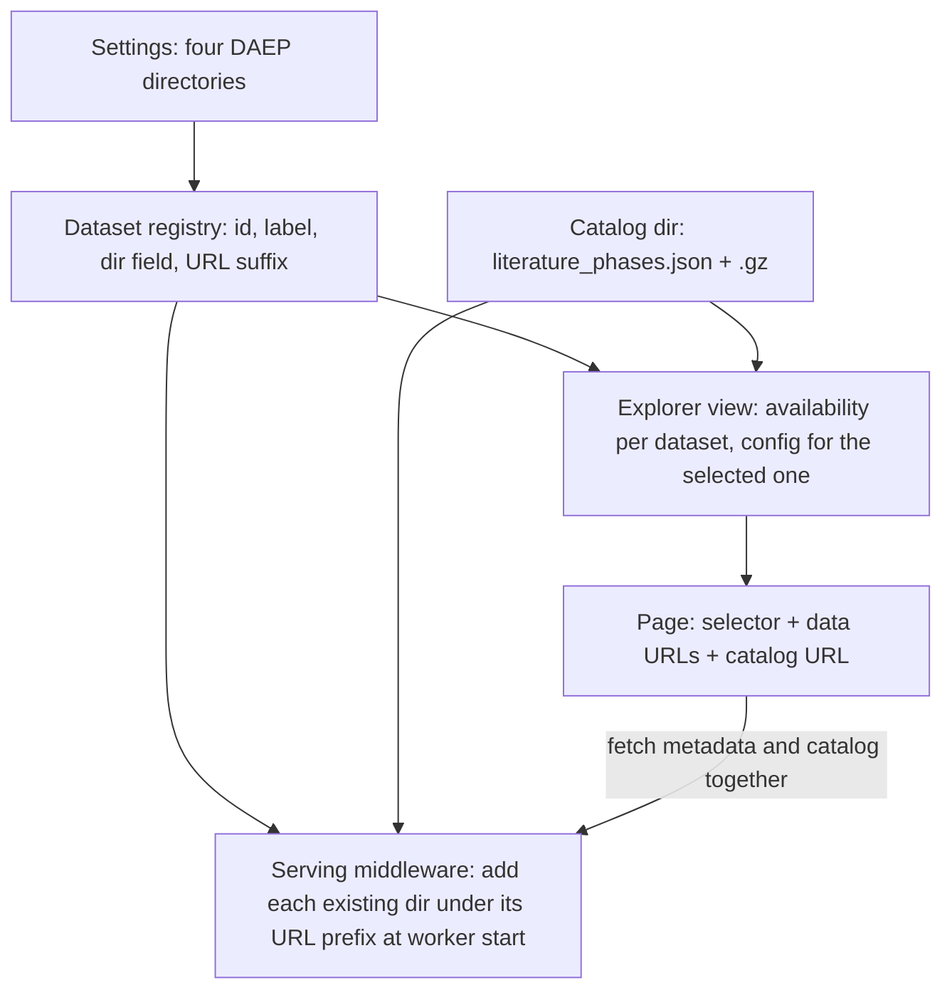

# PR 81 Twins Viewer Readiness - Plan

## Goal Capsule

- **Objective:** Visitors to the Spectral Twins (DAEP) explorer on PROD get PR 81's three-dataset viewer, with page HTML under 100 KB uncompressed for every dataset (R2) and every offered dataset actually installed. The PR author keeps credit for the work on scimma/astrodash#81.
- **Means:** Commits added on top of the author's branch (`pr-81`, head `67f7b71`, from `hnemeh:wiserep-twins-ui`), which the maintainer pushes to that branch as a fast-forward.
- **Product authority:** The maintainer decides scope. The viewer's UI and analysis features as written in PR 81 stay unchanged by this work.
- **Open blockers:** None for planning. Uploading the two new bundles waits on the author confirming the dataset mapping in R10.
- **Execution profile:** One PR, scimma/astrodash#81. The work is commits on a local branch cut from `pr-81` at `67f7b71`. Code units U1-U3 run first. U4 needs the maintainer's S3 upload before its manifest commit. U5 needs a DEV deploy.
- **Stop conditions:** Stop and ask if the author's commits would have to change, if a bundle fails `prepare_twins_bundle` validation, or if the S3 upload or a DEV deploy is needed to continue.
- **Who finishes:** The agent implements, tests and commits locally, and never pushes. The maintainer uploads to S3, builds and deploys the DEV image, pushes the branch to `hnemeh:wiserep-twins-ui`, and merges #81.

---

## Product Contract

### Summary

Finish PR 81 so it is safe to merge. The literature catalog moves out of the page into a data file. Dataset locations come from settings. The new behavior gets tests, and the two new datasets are built and uploaded through the existing data pipeline, so all three datasets are installed when #81 merges.

### Problem Frame

PR 81 adds three selectable DAEP datasets, recurring-twin analysis, spectrum comparison tables and a literature-phase column to the explorer at `/astrodash/twins/`. CI passes, and the PR merges cleanly with current `main`, including after scimma/astrodash#80.

As written, though, it cannot go to PROD. It builds a 1.38 MB literature catalog into the page, so the HTML grows from about 48 KB to 1.47 MB, and PROD serves HTML uncompressed. Two of the three datasets exist on no server, so the public page would offer them as disabled "(data missing)" choices. The new dataset code is never exercised by tests: the existing test mocks the config without `data_dir`, and the new code silently turns itself off under that mock. Dataset paths are also hardcoded in two places, against the project's rule that data paths resolve through settings.

The author shared the raw deliveries for all three datasets. One of them, `Dered36_5`, is byte-identical to the bundle already deployed on DEV and PROD. The literature catalog exists only inside the PR's template.

### Key Decisions

- **Changes land on top of the author's commits, and the maintainer pushes them to #81.** Their six commits stay unchanged, so the PR keeps its number, its discussion and their authorship. Governs R14. (session-settled: user-directed -- chosen over a new bot PR that supersedes #81, and over a review-only reply: keeps the author's PR as the landing record.)
- **The literature catalog lives on the data volume beside the DAEP bundles, as one shared file.** Governs R1, R3. (session-settled: user-directed -- chosen over a static file in the repo and over one copy inside each bundle: keeps the catalog with the DAEP data it describes and out of the page HTML.)
- **All datasets are staged before #81 merges.** The selector keeps the PR's behavior of showing a missing dataset as disabled. Staging makes that state not occur on PROD. Governs R8, R11, R12. (session-settled: user-directed -- chosen over hiding unavailable datasets: the page should launch with all three.)
- **The bundle already deployed is the rest-frame dataset.** `Dered36_5` matches it byte for byte, so it is neither re-uploaded nor duplicated, and the PR's code that picks between an "old" and a "new" rest-frame bundle goes away. Governs R6. (session-settled: user-approved -- chosen over keeping a separate local rest-frame copy with precedence logic: same data, less code and storage.)
- **The two new bundles go through the same pipeline as the current one.** That is `prepare_twins_bundle`, then an S3 upload by the maintainer, then the data manifest. Governs R10, R11.

### Requirements

**Page weight and literature catalog**

- R1. The literature catalog is no longer embedded in the page HTML.
- R2. The explorer page's HTML is back near today's size, under 100 KB uncompressed for every dataset.
- R3. The browser loads the catalog as a separate file from the data volume. When the file is absent or fails to load, the page still works and the literature-phase column is empty.
- R4. The catalog's contents are exactly those in PR 81 (5,083 entries keyed by object name and observation time), extracted from the template unchanged.

**Datasets**

- R5. The explorer offers three datasets: Rest-Frame DAEP, Observer-Frame DAEP and Multi-Object DAEP. Rest-frame is the default.
- R6. Rest-Frame DAEP is served from the bundle already deployed, with no second copy and no precedence logic between bundles.
- R7. A `?dataset=` value that is unknown falls back to Rest-Frame DAEP.
- R8. A dataset whose bundle is missing or incomplete is shown disabled with "(data missing)" and cannot be selected, as in PR 81.

**Configuration**

- R9. Dataset locations resolve through the pydantic settings (`app/astrodash/config/settings.py`, `ASTRODASH_*` env vars), from one shared dataset definition used by both the view and the bundle-serving middleware.

**Data pipeline**

- R10. Observer-Frame DAEP is built from the delivery `Nodered36_5` and Multi-Object DAEP from `Split36_9010`, using `prepare_twins_bundle`. The author confirms this mapping before upload.
- R11. The maintainer uploads the two new bundles and the catalog to the S3 bucket, and the data manifest (`app/entrypoints/astrodash-data.json`) lists them in the same PR.
- R12. Before merge, a DEV deployment from the branch shows all three datasets loading and the literature-phase column populated.

**Tests**

- R13. Tests cover:
  - choosing each dataset;
  - the unknown-dataset fallback (R7);
  - a missing or incomplete bundle being disabled (R8);
  - per-dataset bundle URLs;
  - the middleware serving each dataset under its own URL prefix;
  - the catalog URL given to the page;
  - the page rendering when the catalog is absent (R3).

**Authorship and cleanups**

- R14. The author's six commits stay unchanged, and the new commits apply on top of `67f7b71` as a fast-forward.
- R15. The PR's leftovers are cleaned up:
  - the unreachable `invalid` branch in `spectral_twins.html` is removed;
  - the view's docstring gets Google-style Args/Returns sections;
  - the function-local import in `middleware.py` moves to module level;
  - changed hunks are formatted with black;
  - the leftover iteration markers (`*_V1` ... `*_V4` comments) are removed from the template.

### Acceptance Examples

- AE1. **Covers R3.** **Given** the catalog file is not installed, **when** a visitor opens the explorer, **then** the map, twins and spectra work, and the literature-phase column is empty with no error shown.
- AE2. **Covers R7.** **Given** a visitor requests `?dataset=bogus`, **when** the page renders, **then** Rest-Frame DAEP is selected and loaded.
- AE3. **Covers R8.** **Given** the Observer-Frame bundle lacks its spectra file, **when** the page renders, **then** Observer-Frame DAEP appears disabled with "(data missing)", and the other datasets work.
- AE4. **Covers R6.** **Given** only today's deployed bundle is installed, **when** a visitor opens the explorer, **then** Rest-Frame DAEP loads from it exactly as the page does today.

### Scope Boundaries

- The viewer's UI, layout, analysis features and wording as written in PR 81 are unchanged.
- Server-side DAEP twin search keeps using the rest-frame data only. The new datasets need no server-side reference files.
- Compressing HTML responses on PROD is a separate infrastructure question. R1 removes the need for it here.
- A catalog-preparing management command was considered and not built. The catalog is produced once and checked by U3's equality check, and a bad catalog only blanks an optional column. Build one when a second catalog delivery arrives.
- Showing data staged after a pod starts, without a restart, is not addressed. The data pipeline installs bundles at pod start, so this does not arise.

### Dependencies / Assumptions

- The maintainer holds S3 write credentials, does the upload, and pushes to `hnemeh:wiserep-twins-ui`. GitHub reports that maintainers can modify #81.
- The deliveries are in `/mnt/pophome/CAPS/SCiMMA/DASH/temp/` (`Dered36_5`, `Nodered36_5`, `Split36_9010`), outside the repo.
- Catalog updates follow the data-manifest release path, like bundle updates: an S3 upload, a manifest change, and a new image, because the manifest is built into the image.
- The two new bundles add about 650 MB. DEV's data volume has 3.3 GB free and PROD's has 4.5 GB.
- The mapping in R10 is inferred from directory names and contents: `Nodered36_5` is supernova-only with a "not de-redshifted" name, and `Split36_9010` adds TDEs, CVs and unknown objects.

### Outstanding Questions

- Merge gate, not a planning blocker: the author confirms the dataset mapping in R10 before the maintainer uploads the two bundles.

### Sources / Research

- Data pipeline: `docs/admin/updating-data-files.md`, section "Publishing a DAEP spectral twins bundle"; `app/entrypoints/astrodash-data.json` (manifest); `app/entrypoints/initialize_data.py` (init-container download).
- Bundle format and builder: `app/astrodash/infrastructure/explorer/daep_bundle.py`, `app/astrodash/management/commands/prepare_twins_bundle.py`.
- Current explorer plan: `docs/plans/2026-10-20-0553-feat-daep-spectral-twins-explorer-plan.md`.
- Existing page tests: `app/astrodash/tests/test_spectral_twins_page.py`, `app/astrodash/tests/test_daep_bundle_serving.py`.
- Release and deploy flow: `docs/solutions/workflow-issues/astrodash-tag-driven-release-and-deploy-flow.md`.

Product Contract preservation: changed only in Outstanding Questions, where the planning questions are now answered by KTD1-KTD6; all R-IDs and AE-IDs unchanged.

---

## Planning Contract

### Key Technical Decisions

- KTD1. **One dataset registry drives both the page and the serving middleware.** It lives beside the bundle constants in `app/astrodash/infrastructure/explorer/daep_bundle.py` and lists, per dataset, the id (`rest_frame`, `observer_frame`, `multi_object_rest`, kept from PR 81), the label, the settings field holding its directory, and its URL suffix under `TWINS_BUNDLE_URL_PREFIX`. Rest-frame keeps the bare prefix, so today's bundle URLs and cache keys do not change. The others get `<id>/`, as in PR 81. Governs R5, R6, R9.
- KTD2. **Each new dataset and the catalog get a sibling directory and a settings field.** The fields are `daep_twins_observer_frame_dir` (`/mnt/astrodash-data/explorer/daep_observer_frame`), `daep_twins_multi_object_dir` (`/mnt/astrodash-data/explorer/daep_multi_object`) and `daep_twins_literature_dir` (`/mnt/astrodash-data/explorer/daep_literature`). Rest-frame keeps `daep_twins_bundle_dir`. The S3 paths mirror these under `init/data/explorer/`. This mirrors the existing `daep/` and `daep_server/` layout and replaces PR 81's `local_twins/` subtree. Governs R6, R9, R11.
- KTD3. **The catalog is `literature_phases.json` plus a `.gz` copy, served under `TWINS_BUNDLE_URL_PREFIX` + `literature/`.** WhiteNoise already serves a prepared `.gz` sibling to clients that accept gzip, as it does for `data_meta.json.gz`. The view passes the catalog URL to the page only when the file exists. Governs R1, R3. (session-settled: user-directed -- chosen over a static file in the repo and over one copy inside each bundle: keeps the catalog with the DAEP data it describes and out of the page HTML.)
- KTD4. **The catalog files are produced once by hand: compact JSON plus its gzip copy, extracted from PR 81's template.** The equality check in U3 is the validation. A reusable command was considered and not built (see Scope Boundaries). The bundle descriptor and `BUNDLE_SCHEMA` are unchanged, because the catalog is shared across datasets and optional. Governs R3, R4.
- KTD5. **The page fetches the catalog alongside the metadata and treats any failure as an empty catalog.** The fetch starts with the metadata fetch in `boot()`, so it adds no wait. The rows are built in `init()` as today. A missing URL, a non-200 response or bad JSON all yield `{}`. The column then shows no phases: each cell reads "N/A", the viewer's existing text for an unmatched row. Governs R3.
- KTD6. **The two new bundles are built with `prepare_twins_bundle` and no `--encoder`.** Only its browser-facing output is uploaded. No encoder checkpoint came with the deliveries, the command allows none (`encoder_sha256` is then null), and server-side twin search stays rest-frame only. Governs R10, R11.
- KTD7. **The view drops PR 81's legacy-versus-local precedence and its `invalid` state.** For the selected dataset, the page state is `ok` (valid descriptor plus both data files), `missing` (any file absent) or `unsupported` (descriptor rejected). Those are the states today's template already renders. Governs R6, R8, R15. (session-settled: user-approved -- chosen over keeping a separate local rest-frame copy with precedence logic: same data, less code and storage.)

### High-Level Technical Design

The registry is the one source both request paths read. The page and the middleware never name a directory themselves.

### Assumptions

- The two new deliveries pass `prepare_twins_bundle`'s consistency checks. If one fails, the run stops (Goal Capsule stop conditions) and the author is asked for a corrected delivery.
- The maintainer can regenerate the manifest after uploading, as `docs/admin/updating-data-files.md` Step 2 describes. The bucket is readable anonymously.

---

## Implementation Units

All units commit on a local branch cut from `pr-81` at `67f7b71`. The author's six commits stay untouched (R14).

### U1. Dataset registry, settings and serving

- **Goal:** Each dataset directory and the catalog directory are served under their own URL prefix from one shared definition.
- **Requirements:** R6, R9, R15 (module-level import in the middleware).
- **Dependencies:** none.
- **Files:**
  - `app/astrodash/config/settings.py`
  - `app/astrodash/infrastructure/explorer/daep_bundle.py`
  - `app/astrodash/middleware.py`
  - `app/astrodash/tests/test_daep_bundle_serving.py`
- **Approach:**
  1. Add the three settings fields from KTD2 next to `daep_twins_bundle_dir`.
  2. Add the registry from KTD1 and a catalog filename constant (KTD3) to `daep_bundle.py`.
  3. In `StaticAndTwinsBundleMiddleware.__init__`, replace PR 81's `local_twins` loop with one loop over the registry plus the catalog directory. Each `add_files` call happens only when its directory exists, as the current rest-frame call already tolerates.
  4. Move the `Path` import to module level.
  5. Update `_client_for` in `test_daep_bundle_serving.py` so its settings stub carries all four directory fields, the unused ones pointing at absent temp paths. Production code reads the fields directly, with no `getattr` default.
- **Patterns to follow:** the existing `add_files` call and its docstring in `middleware.py`, and the settings fields around `daep_twins_bundle_dir`.
- **Test scenarios:**
  - An observer-frame directory with `data_spectra.bin` answers a Range request under `TWINS_BUNDLE_URL_PREFIX` + `observer_frame/` with a 206 and the exact bytes.
  - A multi-object directory is served under its own prefix, and its files are not reachable under the observer-frame prefix.
  - Rest-frame files are still served at the bare prefix (the existing test cases pass with only the stub change in step 5).
  - A configured but missing observer-frame directory leaves its prefix returning 404 and does not break rest-frame serving.
  - With a `.gz` copy present, `literature_phases.json` under `literature/` is served gzipped to a client sending `Accept-Encoding: gzip`.
- **Test seam:** these go through the real middleware with a Django test client. They catch prefix, Range and gzip behavior, but not what the browser does with the responses.
- **Verification:** the bundle-serving tests pass, including the unchanged existing cases.

### U2. Explorer view and page states

- **Goal:** The page offers the three datasets from the registry and renders the right state for the selected one, with no precedence logic.
- **Requirements:** R5, R6, R7, R8, R15 (docstring, dead template branch).
- **Dependencies:** U1.
- **Files:**
  - `app/astrodash/ui_views.py`
  - `app/astrodash/templates/astrodash/explorer/spectral_twins.html`
  - `app/astrodash/tests/test_spectral_twins_page.py`
- **Approach:**
  1. Rewrite `spectral_twins` to iterate the registry. A dataset is selectable when its descriptor file and both data files are present, whatever the descriptor's schema. A rejected descriptor renders the `unsupported` warning, and only absent files produce "(data missing)" (KTD7, R8).
  2. Build `twins_config` for the selected dataset with that dataset's URL prefix.
  3. Add the catalog URL to the config when the catalog file exists (KTD3).
  4. Restore the Google-style docstring with Args and Returns.
  5. In `spectral_twins.html`, delete the unreachable inner `invalid` branch.
  6. Update the test helper so the patched config carries all four directory fields as temp dirs, replacing the `SimpleNamespace` that held only `daep_twins_bundle_dir`. Extend `_install_descriptor` to also write `data_meta.json` and `data_spectra.bin`, so the existing `ok`-state tests still reach `ok` under KTD7.
- **Patterns to follow:** today's `spectral_twins` on `main` for the descriptor handling, and the existing tests' `_install_descriptor` helper.
- **Test scenarios:**
  - Covers AE4. With only the rest-frame bundle installed, the page renders `ok` with metadata and spectra URLs at the bare prefix and the bundle id as cache key.
  - With all three bundles installed, `?dataset=observer_frame` renders URLs under `observer_frame/`, and `?dataset=multi_object_rest` under `multi_object_rest/`.
  - Covers AE2. `?dataset=bogus` renders the rest-frame dataset as selected.
  - Covers AE3. With the observer-frame spectra file absent, its selector option is disabled and labelled "(data missing)", and rest-frame still renders `ok`.
  - Requesting an unavailable dataset directly renders the "not installed" state with no bundle URLs.
  - A rest-frame descriptor with an unknown schema renders the format warning.
  - With the catalog file present, the config carries the catalog URL. Without it, the config has no catalog URL and the page still renders `ok`.
- **Test seam:** view-level tests through the Django client catch the server-side state and URLs. They miss the page's JavaScript, which U5 checks by hand.
- **Verification:** the page tests pass, and the existing missing and unknown-schema tests still pass.

### U3. Literature catalog out of the page

- **Goal:** The catalog ships as a validated data file with a gzip copy, and the page loads it separately.
- **Requirements:** R1, R2, R3, R4, R15 (iteration markers).
- **Dependencies:** U1, U2.
- **Files:**
  - `app/astrodash/templates/astrodash/explorer/_spectral_twins_app.html`
  - `app/astrodash/tests/test_spectral_twins_page.py`
- **Approach:**
  1. Extract the catalog JSON from the `literature-phase-catalog` script element at `pr-81`'s head. Write `literature_phases.json` (compact) and `literature_phases.json.gz` to a scratch directory outside the repo, for U4.
  2. In the template, remove the inline catalog element and replace the `JSON.parse` of it with the parallel fetch in KTD5, reading the URL from `twins_config`.
  3. Remove every `*_V<n>` iteration-marker comment, whether written as `//`, `/* */` or `<!-- -->` (12 in PR 81's template).
- **Execution note:** after step 1, compare the produced file against the template's catalog, key for key and value for value, before deleting the inline copy. R4 depends on that equality.
- **Patterns to follow:** `loadMetadata()` in the template for fetch error handling.
- **Test scenarios:**
  - The explorer page's HTML for each available dataset is under 100,000 bytes, and contains no `literature-phase-catalog` element (R1, R2).
- **Test seam:** the page-size test catches a regression of the inline catalog. It does not run the browser fetch, which U5 checks.
- **Verification:** the tests pass, the extracted catalog has 5,083 entries identical to PR 81's, and the `.gz` copy decompresses to the same bytes.

### U4. Build, publish and register the data

- **Goal:** The two new bundles and the catalog are in S3 and listed in the manifest, and the publishing docs describe the three datasets and the catalog.
- **Requirements:** R10, R11.
- **Dependencies:** U3 (catalog files). The author's mapping confirmation and the maintainer's S3 upload gate the manifest step.
- **Files:**
  - `app/entrypoints/astrodash-data.json`
  - `docs/admin/updating-data-files.md`
- **Approach:**
  1. In the dev container, run `prepare_twins_bundle` on `Nodered36_5` and on `Split36_9010` with no encoder (KTD6), each to its own scratch output.
  2. Hand the maintainer the three upload sets: each public bundle directory to `init/data/explorer/daep_observer_frame/` and `init/data/explorer/daep_multi_object/`, and the catalog pair to `init/data/explorer/daep_literature/`.
  3. After the upload, regenerate the manifest (Step 2 of the data doc) and check that it lists the new paths alongside the unchanged `explorer/daep/` entries.
  4. Update the "Publishing a DAEP spectral twins bundle" section with a table row per dataset and a short catalog subsection: compact JSON plus a gzip copy. Note that catalog updates follow the manifest-plus-image path.
- **Test expectation:** none -- data and documentation. The check is that the manifest lists every new file and the local dev stack's data initialization downloads them.
- **Verification:** the manifest diff adds only the new paths, and `explorer/daep/` entries are unchanged.

### U5. DEV check and handoff

- **Goal:** All three datasets and the literature column are confirmed in the real page on DEV, and the maintainer has a fast-forward push for #81.
- **Requirements:** R12, R14.
- **Dependencies:** U1-U4, plus the maintainer's DEV image build and deploy.
- **Files:** none.
- **Approach:**
  1. The maintainer builds an image from the branch and points DEV at it, using the local-build route or a `devN-` tag (see the release-flow learning).
  2. On DEV, load each dataset and check that the map, twins and spectra load and that the literature column shows phases.
  3. Block the catalog URL in the browser and confirm the page still works with "N/A" in the column (AE1).
  4. Hand over the push command for `hnemeh:wiserep-twins-ui` and a draft of an ASCII-only update to #81's description covering the data rollout.
- **Test expectation:** none -- manual verification of deployed behavior, covering what U1-U3's tests cannot reach.
- **Verification:** each check above passes on DEV, and the branch's history starts with the author's six commits unchanged.

---

## Verification Contract

| Gate | Command or check | Applies to |
|---|---|---|
| Test suite | `docker compose --file docker/docker-compose.yml --file docker/docker-compose.dev.yaml --env-file env/.env.default --env-file env/.env.dev --profile slim_dev exec -T app python manage.py test astrodash.tests users.tests` (`run/astrodash.test.sh` is broken) | U1-U3 |
| Known baseline | The only allowed failure is `test_model_access.EntryLinkTokenTests.test_committed_signing_key_refuses_to_mint`, which fails on `main` too | U1-U3 |
| Formatting | `black` on changed hunks only (`ui_views.py` and others are not black-clean on `main`; no drive-by reformatting) | U1-U3 |
| Catalog equality | The extracted catalog equals PR 81's inline catalog, entry for entry | U3 |
| Data | Manifest lists the new paths, and the dev stack's data initialization downloads them | U4 |
| Deployed | The checks in U5 pass on DEV | U5 |

---

## Definition of Done

- R1-R15 hold, each covered by a unit above.
- The full suite passes apart from the known baseline failure.
- The branch is the author's six commits followed by this work, with no change to theirs.
- No leftover code from abandoned approaches remains in the diff.
- The maintainer has the push command and the PR description draft.
